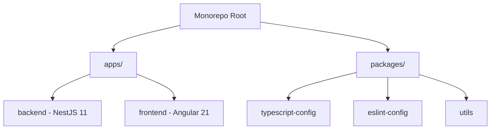
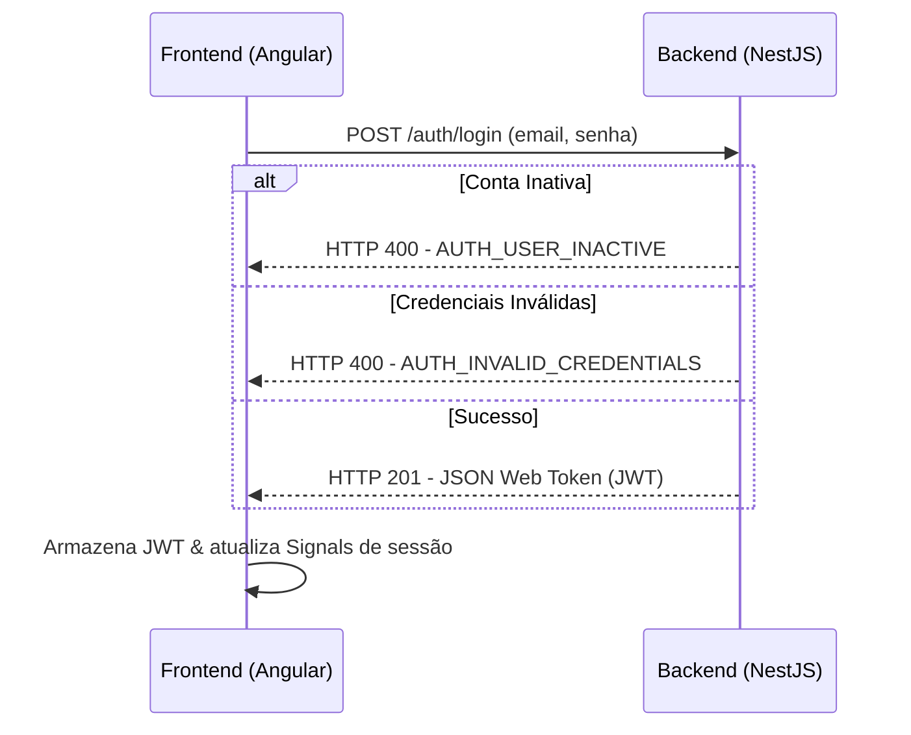

# Especificação Arquitetural do Projeto (specs/arquitetura.md)

Este documento centraliza as diretrizes, padrões e decisões de arquitetura de software adotadas no monorepo para garantir a consistência técnica, facilidade de manutenção e escalabilidade do projeto de ponta a ponta.

---

## 🏗️ 1. Visão Geral e Estrutura do Monorepo

O projeto está estruturado em um **monorepo** gerenciado pelo **Turborepo** e **pnpm workspaces**.



### Tecnologias Principais
* **Gerenciador de Pacotes**: `pnpm` (versão 9.0.0+)
* **Orquestrador de Tarefas**: `turbo` (orquestra builds, lints e testes de forma otimizada)
* **Backend**: NestJS 11, TypeScript 5.x, SQLite com TypeORM
* **Frontend**: Angular 21+, TailwindCSS v4, RxJS 7.x, Vitest

---

## 🔒 2. Fluxo de Autenticação e Segurança

A segurança é implementada de forma integrada entre o backend e o frontend através de tokens JWT de sessão curta (expiração de 60 minutos).



### Backend Guards (NestJS)
* **`JwtAuthGuard`**: Responsável por extrair o token do cabeçalho `Authorization: Bearer <token>`, validá-lo e anexar o usuário autenticado (`AuthenticatedUser`: `{ id, email, nome }`) ao objeto `req.user`. O token não transporta mais roles estáticas.
* **`OperationGuard`**: Utiliza o decorator `@Operation('recurso:acao')` (ex.: `@Operation('users:read')`, `@Operation('categorias:create')`) para interceptar a requisição e validar se o usuário possui a permissão requerida. Consulta o `PermissionsService` (com cache em memória de TTL 5 minutos e invalidação imediata em mutações de usuários e perfis).
* **Catálogo de Permissões**: Disponibilizado em `GET /roles` (`RolesCatalogController`), permitindo descoberta das operações existentes no sistema.

### Frontend Guards (Angular)
* **`authGuard`**: Impede a navegação de usuários não autenticados para rotas privadas, redirecionando-os para `/access-denied` ou `/login`.
* **`roleGuard(role: string)`**: Bloqueia o acesso a rotas restritas caso o usuário logado não possua a permissão necessária. Aguarda o carregamento das roles (`rolesLoaded`) e redireciona para `/access-denied` caso a permissão esteja ausente. Substitui o antigo `adminGuard`.

### Seed de Dados Iniciais e Migrations
O sistema possui migrations versionadas gerenciadas pelo TypeORM (`apps/backend/src/migrations/`) e um `SeedService` (`apps/backend/src/database/seed.service.ts`) executado automaticamente na inicialização da aplicação via o hook `OnModuleInit` do `DatabaseModule`.
As migrations rodam primeiro e, em seguida, o seed é executado de forma **idempotente**:
* **Perfil Administrador**: Criado com todas as roles do sistema (exceto `DADOS_SENSIVEIS`).
* **Perfil Usuário Padrão**: Criado com permissões básicas de consulta.
* **Usuário Administrador**: Criado a partir das variáveis `ADMIN_EMAIL` (default: `admin@ueg.br`) e `ADMIN_PASSWORD` (default: `admin123`), com `ativo: true` e vinculado ao perfil Administrador.

> [!IMPORTANT]
> A variável `JWT_SECRET` é obrigatória para a inicialização do `AuthModule`. Em produção, `ADMIN_PASSWORD` e `JWT_SECRET` devem ser configurados com valores fortes via variáveis de ambiente seguras.

---

## 📊 3. Gerenciamento de Estado Reativo (Frontend)

O frontend adota **Angular Signals** como mecanismo primário de reatividade e controle de estado.

```
                  ┌──────────────────────────────┐
                  │      AuthService (Signals)   │
                  │  - currentUser = signal(...) │
                  │  - roles = signal(string[])  │
                  │  - rolesLoaded = signal(bool)│
                  │  - isAuth = computed(...)    │
                  └──────────────┬───────────────┘
                                 │
                     Modifica / Atualiza
                                 │
                  ┌──────────────▼──────────────┐
                  │    UsersListComponent       │
                  │  - searchQuery = signal()   │
                  │  - filteredUsers = computed │
                  └──────────────┬──────────────┘
                                 │
                          Bind Reativo
                                 │
                  ┌──────────────▼──────────────┐
                  │      Template (HTML)        │
                  │  [ngModel]="searchQuery()"   │
                  └─────────────────────────────┘
```

* **Computed Signals**: Usados para derivar estados síncronos e puros a partir de outros Signals. Por exemplo, o filtro de busca de usuários no painel de administração é derivado dinamicamente:
  ```typescript
  filteredUsers = computed(() => {
    const list = this.usersList();
    const query = this.searchQuery().trim().toLowerCase();
    if (!query) return list;
    return list.filter(u => u.nome.toLowerCase().includes(query));
  });
  ```

---

## 🛜 4. Comunicação, DTOs e Tratamento de Erros

### DTOs de Validação (Backend)
Todos os payloads de entrada dos controllers NestJS devem ser rigidamente validados no nível do DTO usando `class-validator` e `class-transformer` com `ValidationPipe` global (`whitelist: true`, `forbidNonWhitelisted: true`):
```typescript
import { IsEmail, IsNotEmpty, MinLength, IsString } from 'class-validator';

export class CreateManagedUserDto {
  @IsEmail()
  @IsNotEmpty()
  email!: string;

  @IsString()
  @IsNotEmpty()
  nome!: string;

  @MinLength(6)
  senha!: string;
}
```

### Tratamento e Tradução de Erros (`ApiErrorResponse`)
* O backend formata todos os erros no contrato padronizado `ApiErrorResponse` via `GlobalExceptionsFilter`:
  ```typescript
  export interface ApiErrorResponse {
    statusCode: number;
    error: string;
    message: string;
    timestamp: string;
    path: string;
    details?: unknown;
  }
  ```
* Erros de negócio estendem `BusinessException` com código semântico e status HTTP apropriado (ex: 400, 404, 409).
* Em falhas de concorrência por versão otimista (`versao` desatualizada), é lançada uma `OptimisticLockException` (409 `OPTIMISTIC_LOCK_CONFLICT`).
* Erros não tratados (500) retornam `INTERNAL_ERROR` sem vazamento de stack traces em respostas de produção.
* O frontend consome essa estrutura através de `parseAuthError` em `apps/frontend/src/app/core/utils/error-handler.util.ts`:
  ```typescript
  export function parseAuthError(error: any): string {
    const code = error?.error?.error;
    if (code === 'AUTH_EMAIL_EXISTS') return 'Este e-mail já está em uso.';
    if (code === 'AUTH_USER_INACTIVE') return 'Sua conta está aguardando liberação do administrador.';
    if (code === 'AUTH_INVALID_CREDENTIALS') return 'E-mail ou senha incorretos.';
    return error?.error?.message || 'Ocorreu um erro inesperado.';
  }
  ```

---

## 🧩 5. CRUD Genérico e Permissões Dinâmicas

A arquitetura do backend disponibiliza um framework de CRUD genérico reutilizável e extensível que integra:
1. **`BaseEntity`**: Herança padrão para entidades com `id` (UUID), `dataCriacao`, `dataAtualizacao`, `ativo`, `versao` (optimistic locking incremental automático) e `ultimoUsuarioId`.
2. **`CrudConfig`**: Configurações de rotas (`resourceName`), ordenação default, limites de paginação (`limit` máx 5000), campos pesquisáveis (`searchFields`), filtros exatos (`allowedFilters`) e relações carregadas.
3. **`CrudService<E>`**: Implementação base das operações `findAll`, `findOne`, `create`, `update`, `remove` e `restore`. Suporta paginação `PageResult<E>`, filtros, ordenação segura e transações via `TransactionRunner`.
4. **`createCrudController<E>`**: Factory de Controllers NestJS com rotas REST padronizadas protegidas automaticamente por `@Operation('resource:action')` e `JwtAuthGuard`.
5. **Mascaramento de Dados Sensíveis**: Campos decorados com `@Sensitive()` são automaticamente mascarados (substituídos por `null`) para qualquer usuário que não possua a role especial `DADOS_SENSIVEIS`.
6. **Controle de Concorrência SQLite**: Inclusão de Mutex (`async-mutex`) e `TransactionRunner` para serializar operações de escrita e evitar bloqueios (`SQLITE_BUSY`).
7. **Documentação Automática OpenAPI (Swagger)**: Todos os endpoints (autenticação, catálogo de permissões e CRUD genérico) são documentados automaticamente via `@nestjs/swagger` com tags, schemas de DTOs, parâmetros de busca/paginação, códigos de retorno HTTP e suporte a Bearer JWT, acessível na rota `/api/docs`.

### Como criar um novo CRUD em 5 passos:
Para criar um CRUD completo (exemplo de `Categoria`):
1. **Entidade**: Crie `Categoria` estendendo `BaseEntity` com decorators do TypeORM e `@Sensitive()` nos campos restritos.
2. **DTOs**: Crie `CreateCategoriaDto` e `UpdateCategoriaDto` com validações de `class-validator`.
3. **Migration**: Crie a migration da tabela com os índices adequados.
4. **Service e Validador**: Crie `CategoriasService extends CrudService<Categoria>` definindo a `CrudConfig`. Caso haja regras de validação de negócio (como nome único ou integridade relacional), implemente um `CrudValidator<Categoria>`.
5. **Controller e Módulo**: Crie `CategoriasController extends createCrudController(...)` e registre a entidade, o service e o controller no `CategoriasModule`. As roles (`categorias:read`, `categorias:create`, etc.) serão registradas e validadas automaticamente!

---

## 🎯 6. Políticas de Qualidade e Governança de Código

Para garantir a sustentabilidade do projeto no longo prazo, todos os agentes de IA e desenvolvedores humanos devem obedecer às seguintes regras de qualidade:

### 🚫 Proibição Estrita do Tipo `any` (TypeScript)
O uso do tipo genérico `any` em TypeScript é **estritamente proibido** no frontend e no backend. Toda e qualquer variável, parâmetro, retorno de função e propriedade deve ser tipada de forma forte e precisa.
* **Exceção única**: O tipo `any` só poderá ser utilizado caso haja uma orientação ou restrição técnica explícita na especificação do usuário.
* **Exemplo de correção**: Em controllers onde o Express Request é injetado, deve-se utilizar a tipagem de requisição do Express ou uma interface especializada em vez de `any`:
  ```typescript
  import { Request as ExpressRequest } from 'express';
  // CORRETO:
  async login(@Request() req: ExpressRequest)
  ```

### 🧪 100% de Cobertura em Testes (TDD Mandatório)
* **Backend**: Utiliza **Jest**. Todos os módulos de lógica de negócio (`UsersService`, `AuthService`, utilitários) devem ter arquivos `.spec.ts` com cobertura completa de casos de erro e sucesso.
* **Frontend**: Utiliza **Vitest** e `@angular/core/testing` (TestBed). Componentes baseados em Signals, guards de roteamento e serviços HTTP devem possuir testes spec mockados completos para garantir que modificações futuras não quebrem funcionalidades existentes.
