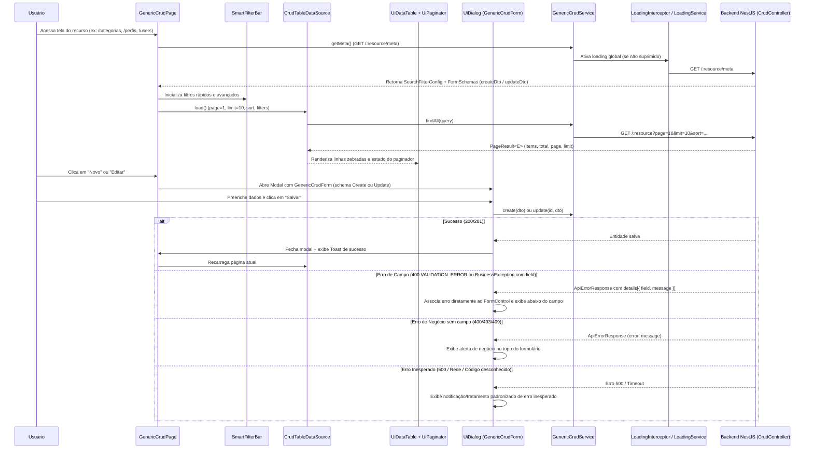

# Especificação: Arquitetura de CRUD Genérico no Frontend, Metadados por Reflexão, SmartFilterBar, Tratamento de Erros e Controle Global de Loading

> **Status:** APROVADA PARA PLANEJAMENTO (Todas as decisões arquiteturais, de UI/UX, metadados de reflexão, tratamento de erros em 3 níveis, Loading Global e bibliotecas de Dialog/Toast foram definidas).
> **Plano técnico:** [specs/plan/crud-generico-frontend-plan.md](plan/crud-generico-frontend-plan.md)
> **Documentos relacionados:** [specs/crud-generico.md](crud-generico.md), [specs/arquitetura.md](arquitetura.md), [specs/design-system.md](design-system.md), [specs/auth.md](auth.md)

---

## 1. Visão Geral

### 1.1 História de Usuário
**Como** desenvolvedor da plataforma UEG,
**quero** uma arquitetura genérica e parametrizável de CRUD no frontend (serviços, fonte de dados de tabela, paginador, barra de busca inteligente `SmartFilterBar`, formulário dinâmico orientado por metadados de reflexão dos DTOs do backend e página padrão de listagem/operações), integrada a um tratamento padronizado de erros (de campo, de negócio e inesperados), controle global de loading e componentes encapsulados de Dialog e Toast,
**para** construir cadastros completos (como **Categorias**, **Perfis** e **Usuários**) com o mínimo de código repetitivo, mantendo total aderência ao Design System institucional.

### 1.2 Escopo desta Entrega
| Item | Incluído |
| :--- | :---: |
| Contratos compartilhados de Metadados (Filtros, Formulário, Erros de Campo) em `@repo/utils` | ✅ |
| Ajuste no `BusinessException` do backend para suportar vínculo opcional com campo (`field` / `details`) | ✅ |
| Extrator de Metadados por Reflexão no Backend (`DtoMetadataExplorer` + `@FormFieldMeta`) | ✅ |
| Serviço e Endpoint padrão de Metadados de Busca (`GET /:resource/meta/filters` + interface reutilizável) | ✅ |
| Endpoint padrão de Metadados de Formulário (`GET /:resource/meta/form` ou unificado em `GET /:resource/meta`) | ✅ |
| Suporte a filtro por relacionamento (`relationField`) no `crud-query.ts` do backend | ✅ |
| Camada de Serviço Genérico no Frontend (`GenericCrudService<E, C, U>`) | ✅ |
| Abstração reativa de dados de tabela (`CrudTableDataSource<E>`) com Signals | ✅ |
| Componente de Tabela (`UiDataTableComponent`) zebrada, multi-sort (`Shift + Clique`) e coluna de operações | ✅ |
| Componente de Paginador (`UiPaginatorComponent`) com seleção de linhas por página | ✅ |
| Componente de Busca Padronizado (`SmartFilterBarComponent`) com filtros rápidos (texto, select, mestre-detalhe) e avançados | ✅ |
| Componente de Formulário Genérico (`GenericCrudFormComponent`) orientado pelos DTOs de Create e Update | ✅ |
| Tela Inicial de CRUD Genérico (`GenericCrudPageComponent`) com Modal de Inclusão/Edição e Confirmação de Exclusão | ✅ |
| Serviço Singleton de Loading Global (`LoadingService` + `loadingInterceptor` com opt-out por requisição) | ✅ |
| Encapsulamento padronizado de **Dialog** e **Toast** sobre bibliotecas padrão de mercado | ✅ |
| Tratamento estruturado de erros no Frontend (erros por campo no formulário, erros de negócio gerais e erros 500/inesperados) | ✅ |
| Implementação completa dos cadastros de **Categorias**, **Perfis** e **Usuários** + atualização da Sidebar e Rotas | ✅ |

---

## 2. Visão Arquitetural



---

## 3. Contratos Compartilhados (`@repo/utils`) e Ajustes no Backend

### 3.1 Evolução do Contrato de Erro (`packages/utils/src/contracts/api-error.ts`)
Para permitir que **erros de validação de negócio no backend** (como `USER_EMAIL_EXISTS`, `CATEGORIA_NOME_EXISTS`, `PERFIL_NOME_EXISTS`, `USER_PERFIL_INVALID`, `PERFIL_ROLE_INVALID`) sejam vinculados diretamente ao campo correspondente no formulário do frontend:

```typescript
export interface ApiErrorDetail {
  field: string;
  message: string;
}

export interface ApiErrorResponse {
  statusCode: number;
  error: string;
  message: string;
  details?: ApiErrorDetail[];
  path: string;
  timestamp: string;
}
```

#### Evolução da `BusinessException` no Backend (`apps/backend/src/common/exceptions/business.exception.ts`)
A classe `BusinessException` passa a aceitar um quarto parâmetro opcional (`detailsOrField?: string | ApiErrorDetail[]`):
- Se for passada uma `string` (ex: `'email'`), o `AllExceptionsFilter` gera automaticamente `details: [{ field: 'email', message }]`.
- Se for passado `ApiErrorDetail[]`, repassa diretamente em `details`.
- Se omitido (ex: `USER_LAST_ADMIN`, `PERFIL_SISTEMA_PROTEGIDO`, `PERFIL_IN_USE`, `OPTIMISTIC_LOCK_CONFLICT`), `details` permanece `undefined`, caracterizando um **erro de negócio de escopo geral** (não atrelado a um único input).

Mapeamento nos serviços existentes do backend:
| Serviço | Código de Erro | Campo vinculado (`field`) | Escopo |
| :--- | :--- | :---: | :--- |
| `CategoriasService` | `CATEGORIA_NOME_EXISTS` | `'nome'` | Campo |
| `PerfisService` | `PERFIL_NOME_EXISTS` | `'nome'` | Campo |
| `PerfisService` | `PERFIL_ROLE_INVALID` | `'roles'` | Campo |
| `PerfisService` | `PERFIL_SISTEMA_PROTEGIDO` | `undefined` | Geral (Negócio) |
| `PerfisService` | `PERFIL_IN_USE` | `undefined` | Geral (Negócio) |
| `UsersService` | `USER_EMAIL_EXISTS` | `'email'` | Campo |
| `UsersService` | `USER_PERFIL_INVALID` | `'perfilIds'` | Campo |
| `UsersService` | `USER_LAST_ADMIN` | `undefined` | Geral (Negócio) |
| `CrudService` | `OPTIMISTIC_LOCK_CONFLICT` | `undefined` | Geral (Negócio) |
| `CrudService` | `FORBIDDEN_SENSITIVE_FIELD` | `undefined` (ou campo) | Geral / Permissão |

---

### 3.2 Contratos de Metadados de Busca para o `SmartFilterBar` (`packages/utils/src/contracts/crud-meta.ts`)

```typescript
import { FilterOperator } from './pagination';

export type FilterFieldType = 'string' | 'number' | 'boolean' | 'date' | 'uuid';

export type FilterControlType =
  | 'text'
  | 'number'
  | 'currency'
  | 'boolean'
  | 'date'
  | 'select'
  | 'multiselect'
  | 'master-detail';

export interface FilterOptionItem {
  label: string;
  value: string | number | boolean;
}

export interface MasterDetailFilterConfig {
  /** Nome do campo pai no filtro (ex: 'perfilId') */
  parentField: string;
  /** Label do select pai */
  parentLabel: string;
  /** Endpoint para carregar opções do pai (ex: '/perfis') */
  parentEndpoint: string;
  parentValueKey?: string;
  parentLabelKey?: string;
  /** Endpoint para carregar opções do filho filtradas pelo pai (ex: '/roles?perfilId={parentValue}') */
  childEndpoint: string;
  /** Nome do query param enviado ao childEndpoint com o valor do pai */
  parentParamName: string;
  childValueKey?: string;
  childLabelKey?: string;
}

export interface SmartFilterFieldMeta {
  /** Nome do parâmetro de filtro enviado na query string (ex: 'nome', 'ativo', 'perfilId') */
  field: string;
  /** Rótulo exibido na interface */
  label: string;
  /** Tipo primitivo de dado para coerção e operadores */
  type: FilterFieldType;
  /** Tipo do componente visual */
  controlType: FilterControlType;
  /** Operadores permitidos para este campo nos Filtros Avançados */
  operators: FilterOperator[];
  /** Operador padrão utilizado quando preenchido na barra rápida (ex: 'like' para texto, 'eq' para select) */
  defaultOperator: FilterOperator;
  /** Define se o campo é exibido diretamente na barra inicial do SmartFilterBar */
  quickFilter: boolean;
  /** Placeholder opcional para o controle */
  placeholder?: string;
  /** Opções estáticas para select/boolean */
  options?: FilterOptionItem[];
  /** Endpoint da API para buscar opções dinâmicas (ex: '/perfis') */
  optionsEndpoint?: string;
  optionsValueKey?: string;
  optionsLabelKey?: string;
  /** Configuração para select mestre-detalhe (cascata) */
  masterDetail?: MasterDetailFilterConfig;
  /** Role necessária para visualizar/filtrar por este campo (ex: 'DADOS_SENSIVEIS') */
  requiredRole?: string;
}

export interface SearchFilterConfigDto {
  resource: string;
  fields: SmartFilterFieldMeta[];
}
```

#### Interface e Serviço Reutilizável no Backend (`ISmartFilterConfigProvider`)
Para que outros casos de uso que **não** utilizam `CrudService` também possam fornecer metadados para o `SmartFilterBar`:
- Define-se a interface `ISmartFilterConfigProvider`:
  ```typescript
  export interface ISmartFilterConfigProvider {
    getSearchFilterConfig(userRoles: ReadonlySet<string>): SearchFilterConfigDto;
  }
  ```
- Define-se o serviço utilitário `SmartFilterMetadataService` que constrói `SearchFilterConfigDto` filtrando automaticamente campos que exigem uma `requiredRole` (ou `@MaskedField`) não presente em `userRoles`.
- No `CrudService`, essa interface já é implementada nativamente a partir do `CrudConfig`.

#### Suporte a Filtro por Relacionamento no `crud-query.ts`
No `FilterRule` do `CrudConfig`:
- Adiciona-se a propriedade opcional `relationField?: string` (ex: `perfilId: { type: 'uuid', operators: ['eq', 'in'], relationField: 'perfis.id', ... }`).
- Quando `f.relationField` estiver configurado em `applyToQueryBuilder`, o filtro realiza o `leftJoin` / `innerJoin` na relação (se ainda não juntada) e aplica a condição `WHERE` sobre a coluna da relação (`perfis.id = :p_0`), permitindo filtrar usuários por perfil no `SmartFilterBar`!

---

### 3.3 Contratos e Reflexão do Formulário Genérico (`DtoMetadataExplorer` e `@FormFieldMeta`)

#### Decorator `@FormFieldMeta` no Backend (`apps/backend/src/common/crud/decorators/form-field-meta.decorator.ts`)
Complementa as anotações do `class-validator` e `@nestjs/swagger` nos DTOs:

```typescript
export type FormInputType =
  | 'text'
  | 'email'
  | 'password'
  | 'number'
  | 'currency'
  | 'boolean'
  | 'select'
  | 'multiselect'
  | 'date'
  | 'hidden';

export interface FormFieldMetaOptions {
  label?: string;
  inputType?: FormInputType;
  placeholder?: string;
  order?: number;
  hidden?: boolean;
  readOnly?: boolean;
  /** Endpoint para popular select / multiselect (ex: '/perfis', '/roles') */
  optionsEndpoint?: string;
  optionsValueKey?: string;
  optionsLabelKey?: string;
  optionsStatic?: FilterOptionItem[];
  /** Nome da propriedade na entidade retornada pelo GET /:id para mapear relações (ex: 'perfis' -> 'perfilIds') */
  entityRelationProperty?: string;
  entityRelationValueKey?: string;
}
```

#### Como funciona o `DtoMetadataExplorer` (Reflexão no Backend)
Ao inspecionar `config.createDto` e `config.updateDto` (incluindo classes base da cadeia de protótipos como `BaseManagedUserDto` e `createUpdateDto`):
1. **Propriedades do Swagger (`Reflect.getMetadata('swagger/apiModelPropertiesArray', dto.prototype)`)**:
   - Obtém a lista de propriedades do DTO, `type`, `example`, `description`, `default`, `nullable`, `required`.
2. **Regras do `class-validator` (`getMetadataStorage().getTargetValidationMetadatas(...)`)**:
   - Extrai automaticamente para cada propriedade:
     - `required`: presença de `isNotEmpty` e ausência de `isOptional`.
     - `minLength` / `maxLength`: valores numéricos e mensagens de erro customizadas.
     - `min` / `max`: valores limites e mensagens.
     - `isEmail`, `isInt`, `isBoolean`, `isArray`, `isUUID`.
3. **Cruzamento com `@MaskedField` da Entidade**:
   - Se a propriedade possui `@MaskedField` na `config.entity`:
     - Anexa `requiredRole` (ex: `'DADOS_SENSIVEIS'`).
     - Se o usuário autenticado na requisição não possuir a role, marca `readOnly: true`, `masked: true` e `omitOnSubmit: true` para que o frontend desabilite o controle e não o envie no payload.
4. **Enriquecimento com `@FormFieldMeta`**:
   - Sobrescreve/define `label`, `inputType`, `optionsEndpoint`, `entityRelationProperty` (ex: `perfis` → extrai `.map(p => p.id)` para popular `perfilIds` na edição).
   - O campo `version` do `UpdateDto` é automaticamente marcado com `inputType: 'hidden'`.

#### Contrato Compartilhado de Metadados do Formulário (`packages/utils/src/contracts/crud-meta.ts`)
```typescript
export interface FormFieldValidationRule {
  type: 'required' | 'minLength' | 'maxLength' | 'min' | 'max' | 'email' | 'int' | 'uuid';
  value?: number | string | boolean;
  message?: string;
}

export interface CrudFormFieldSchema {
  name: string;
  label: string;
  inputType: FormInputType;
  required: boolean;
  defaultValue?: unknown;
  placeholder?: string;
  description?: string;
  order: number;
  hidden: boolean;
  readOnly: boolean;
  masked?: boolean;
  omitOnSubmit?: boolean;
  requiredRole?: string;
  validations: FormFieldValidationRule[];
  options?: FilterOptionItem[];
  optionsEndpoint?: string;
  optionsValueKey?: string;
  optionsLabelKey?: string;
  entityRelationProperty?: string;
  entityRelationValueKey?: string;
}

export interface CrudFormSchemaDto {
  mode: 'create' | 'update';
  fields: CrudFormFieldSchema[];
}

export interface CrudResourceMetaDto {
  resource: string;
  filters: SearchFilterConfigDto;
  createForm: CrudFormSchemaDto;
  updateForm: CrudFormSchemaDto;
}
```

#### Endpoints de Metadados no `createCrudController`
No `createCrudController`:
- **`GET /:resource/meta`** (protegido por `@Operation('${resource}:read')`): retorna `CrudResourceMetaDto` completo (filtros + schemas de criação e edição).
- **`GET /:resource/meta/filters`** (protegido por `@Operation('${resource}:read')`): retorna apenas `SearchFilterConfigDto` (padrão para o `SmartFilterBar`).
- **`GET /:resource/meta/form`** (protegido por `@Operation('${resource}:read')`): retorna `{ createForm, updateForm }`.
*(Importante: as rotas `/meta`, `/meta/filters` e `/meta/form` devem ser declaradas antes de `@Get(':id')` no controller base para não colidirem com o `ParseUUIDPipe` do `:id`).*

---

## 4. Arquitetura dos Serviços e Componentes no Frontend (`apps/frontend`)

### 4.1 Camada de Serviço Genérico (`GenericCrudService<E, C, U>`)
Localização: `apps/frontend/src/app/core/crud/generic-crud.service.ts`

```typescript
export interface CrudQueryState {
  page: number;
  limit: number;
  sorts: { field: string; direction: 'ASC' | 'DESC' }[];
  filters: { field: string; operator: FilterOperator; value: unknown }[];
}
```

Responsabilidades do `GenericCrudService<E extends { id: string; version?: number }, C = Record<string, unknown>, U = Record<string, unknown>>`:
- Recebe `protected readonly resource: string` (ex: `'categorias'`, `'perfis'`, `'users'`).
- Constrói a URL base `${environment.apiUrl}/${this.resource}`.
- **Métodos**:
  - `getMeta(): Observable<CrudResourceMetaDto>` (com cache em memória por sessão/roles via `shareReplay(1)` ou recarregado se as roles mudarem).
  - `getFilterMeta(): Observable<SearchFilterConfigDto>`
  - `findAll(state: Partial<CrudQueryState>): Observable<PageResult<E>>`:
    - Converte `page` e `limit`.
    - Converte `sorts` para `sort=campo1:ASC,campo2:DESC`.
    - Converte `filters` para `campo__operador=valor` (tratando arrays e `between` com `.join(',')`).
  - `findOne(id: string): Observable<E>`
  - `create(dto: C): Observable<E>`
  - `update(id: string, dto: U): Observable<E>`
  - `remove(id: string, version?: number): Observable<void>` (envia `?version=${version}` quando informado).

#### Exemplo de Serviço Específico com Código Mínimo:
```typescript
@Injectable({ providedIn: 'root' })
export class CategoriasCrudService extends GenericCrudService<CategoriaDto> {
  constructor() {
    super('categorias');
  }
}
```
E para `UsersCrudService`:
```typescript
@Injectable({ providedIn: 'root' })
export class UsersCrudService extends GenericCrudService<UserDto> {
  constructor() {
    super('users');
  }

  activate(id: string): Observable<UserDto> {
    return this.http.patch<UserDto>(`${this.baseUrl}/${id}/activate`, {});
  }

  resetPassword(id: string): Observable<{ message: string }> {
    return this.http.post<{ message: string }>(`${this.baseUrl}/${id}/reset-password`, {});
  }
}
```

---

### 4.2 Abstração `CrudTableDataSource<E>`
Localização: `apps/frontend/src/app/shared/components/crud/crud-table-data-source.ts`

Encapsula de forma reativa (Signals) os dados, colunas, ordenação e paginação para que o `UiDataTableComponent` e o `UiPaginatorComponent` operem desacoplados do serviço específico:

```typescript
export interface TableColumnDef<E> {
  /** Chave da propriedade na entidade (suporta caminhos ou chave virtual) */
  key: keyof E & string | string;
  /** Título exibido no cabeçalho */
  label: string;
  /** Indica se a coluna permite ordenação */
  sortable?: boolean;
  /** Campo enviado no parâmetro sort (padrão = key) */
  sortField?: string;
  /** Tipo de renderização da célula */
  type?: 'text' | 'boolean' | 'currency-cents' | 'date' | 'datetime' | 'badges' | 'custom';
  /** Alinhamento da coluna */
  align?: 'left' | 'center' | 'right';
  /** Role exigida para exibir a coluna de forma desmascarada */
  requiredRole?: string;
  /** Valor de máscara retornado pelo backend (ex: 99999) */
  maskedSentinel?: unknown;
  /** Configuração para tipo boolean */
  booleanLabels?: {
    trueLabel: string;
    falseLabel: string;
    trueVariant?: 'success' | 'info' | 'default';
    falseVariant?: 'warning' | 'secondary' | 'destructive' | 'outline';
  };
  /** Extrator de itens para tipo 'badges' (ex: user.perfis.map(p => p.nome)) */
  badgeExtractor?: (row: E) => { label: string; variant?: 'info' | 'secondary' | 'default' }[];
  /** Formatador customizado de texto */
  formatter?: (row: E) => string;
}

export interface TableRowAction<E> {
  id: string;
  label: string | ((row: E) => string);
  icon?: string;
  variant?: 'default' | 'destructive' | 'outline' | 'secondary' | 'ghost';
  /** Role necessária para exibir a ação */
  permission?: string;
  /** Condição para exibir o botão na linha */
  visible?: (row: E) => boolean;
  /** Condição para desabilitar o botão na linha (ex: perfil.sistema === true) */
  disabled?: (row: E) => boolean;
  disabledTooltip?: string;
  handler: (row: E) => void;
}
```

**Signals e Métodos do `CrudTableDataSource<E>`**:
- `readonly items = signal<E[]>([])`
- `readonly total = signal<number>(0)`
- `readonly page = signal<number>(1)`
- `readonly limit = signal<number>(10)`
- `readonly pageSizeOptions = signal<number[]>([10, 25, 50, 100])`
- `readonly sorts = signal<{ field: string; direction: 'ASC' | 'DESC' }[]>([])`
- `readonly filters = signal<{ field: string; operator: FilterOperator; value: unknown }[]>([])`
- `readonly isLoading = signal<boolean>(false)`
- `readonly columns = signal<TableColumnDef<E>[]>([])`
- `readonly actions = signal<TableRowAction<E>[]>([])`
- **Métodos**:
  - `toggleSort(field: string, multiSort: boolean)`:
    - Se `multiSort === false` (clique simples):
      - Se a coluna não estava ordenada (ou havia múltiplas colunas), define `[{ field, direction: 'ASC' }]`.
      - Se estava `ASC`, muda para `[{ field, direction: 'DESC' }]`.
      - Se estava `DESC`, limpa para `[]`.
    - Se `multiSort === true` (`Shift + Clique`):
      - Se a coluna já está na lista `sorts`: alterna `ASC` → `DESC` → remove da lista mantendo as demais.
      - Se não está na lista: adiciona `{ field, direction: 'ASC' }` ao final da lista `sorts`.
    - Volta para `page = 1` e dispara `refresh()`.
  - `setPage(page: number)` → dispara `refresh()`.
  - `setPageSize(limit: number)` → reseta `page = 1` e dispara `refresh()`.
  - `setFilters(filters)` → reseta `page = 1` e dispara `refresh()`.
  - `refresh()` → chama `service.findAll(...)` e atualiza `items` e `total`.

---

### 4.3 Componente de Tabela (`UiDataTableComponent`) e Paginador (`UiPaginatorComponent`)

#### `UiDataTableComponent` (`apps/frontend/src/app/shared/components/crud/ui-data-table.component.ts`)
- **Inputs**:
  - `dataSource = input.required<CrudTableDataSource<E>>()`
  - `emptyTitle = input<string>('Nenhum registro encontrado')`
  - `emptyDescription = input<string>('Tente ajustar os filtros de busca ou adicione um novo registro.')`
- **Comportamento Visual**:
  - Cabeçalho com `bg-muted/60`, colunas ordenáveis clicáveis com cursor pointer e indicador visual:
    - Ícone neutro quando não ordenado.
    - Seta para cima (`ASC`) ou para baixo (`DESC`) em destaque (`text-primary`).
    - Quando `dataSource.sorts().length > 1`, exibe um pequeno badge numérico (`1`, `2`, ...) ao lado da seta indicando a ordem de prioridade da ordenação múltipla.
    - Passa `$event.shiftKey` para `dataSource.toggleSort(col.sortField || col.key, $event.shiftKey)`.
  - **Linhas Zebradas**:
    - Classes nas linhas `<tr>`: `odd:bg-background even:bg-muted/30 hover:bg-primary/5 transition-colors`.
  - **Renderização Automática de Células por Tipo**:
    - `'text'`: texto simples ou `col.formatter(row)`.
    - `'boolean'`: renderiza `<ui-badge>` com `trueLabel`/`falseLabel` e variantes semânticas (`success`/`warning` ou `secondary`).
    - `'currency-cents'`:
      - Se o usuário não possui a `col.requiredRole` (ex: `DADOS_SENSIVEIS`) ou o valor é igual a `col.maskedSentinel` (`99999`), exibe `<ui-badge variant="outline">R$ •••••</ui-badge>` (com tooltip indicando dado restrito).
      - Caso contrário, formata `(valor / 100)` em `Intl.NumberFormat('pt-BR', { style: 'currency', currency: 'BRL' })` (ou `—` se `null`).
    - `'date'` / `'datetime'`: formata data em `pt-BR`.
    - `'badges'`: renderiza lista de `<ui-badge>` (ou texto `"Nenhum"` quando vazio).
  - **Coluna de Operações**:
    - Renderizada à direita quando existem ações visíveis para o usuário.
    - Respeita `authService.hasRole(action.permission)` e as funções `action.visible(row)` e `action.disabled(row)`.

#### `UiPaginatorComponent` (`apps/frontend/src/app/shared/components/crud/ui-paginator.component.ts`)
- **Inputs/Outputs**:
  - Pode receber diretamente `dataSource = input<CrudTableDataSource<unknown>>()` ou inputs individuais (`page`, `limit`, `total`, `pageSizeOptions`) e outputs (`pageChange`, `limitChange`).
- **Funcionalidades**:
  - Seletor **"Itens por página"** (`10`, `25`, `50`, `100`).
  - Indicador textual: `"Exibindo X a Y de Z registros"`.
  - Botões de navegação: Primeira página (`«`), Anterior (`‹`), Números de página (com elipses inteligentes), Próxima (`›`) e Última página (`»`).

---

### 4.4 Componente `SmartFilterBarComponent`
Localização: `apps/frontend/src/app/shared/components/crud/smart-filter-bar.component.ts`

- **Inputs e Outputs**:
  - `config = input.required<SearchFilterConfigDto | null>()`
  - `filterChange = output<{ field: string; operator: FilterOperator; value: unknown }[]>()`
- **Estrutura Visual**:
  1. **Barra Principal (Filtros Rápidos)**:
     - Exibe todos os campos onde `field.quickFilter === true`:
       - **Campo de Texto (`controlType === 'text'`)**: Input com ícone de busca e suporte a `Enter` para disparar a pesquisa.
       - **Select Simples (`controlType === 'select' | 'boolean'`)**: Dropdown com opção `"Todos"` + opções estáticas (`field.options`) ou carregadas automaticamente de `field.optionsEndpoint`.
       - **Select Mestre-Detalhe (`controlType === 'master-detail'`)**:
         - Renderiza dois selects conectados: o **Select Mestre** (carregado de `masterDetail.parentEndpoint`) e o **Select Detalhe** (desabilitado até que o Mestre seja selecionado; ao selecionar um valor no Mestre, busca automaticamente em `masterDetail.childEndpoint?${parentParamName}=${parentValue}` e habilita o Select Detalhe).
     - **Botão "Buscar"** (`variant="default"`): aplica os filtros preenchidos.
     - **Botão "Limpar"** (`variant="ghost"`): limpa todos os filtros rápidos e avançados e recarrega a listagem.
     - **Botão "Filtros Avançados"** (`variant="outline"`): abre/expande o painel de filtros avançados e mostra um `<ui-badge>` com a quantidade de regras avançadas ativas.
  2. **Painel de Filtros Avançados (Expansível / Popover)**:
     - Permite adicionar `0..N` linhas de filtro detalhado.
     - Cada linha possui:
       1. **Seletor de Campo**: lista todos os `config.fields` permitidos para o usuário.
       2. **Seletor de Operador (Tipo de Busca)**: lista apenas os `field.operators` válidos para o campo selecionado, com rótulos traduzidos:
          - `eq`: `"Igual a"`
          - `ne`: `"Diferente de"`
          - `like`: `"Contém"`
          - `gt`: `"Maior que"`
          - `gte`: `"Maior ou igual a"`
          - `lt`: `"Menor que"`
          - `lte`: `"Menor ou igual a"`
          - `between`: `"Entre (intervalo)"`
          - `in`: `"Na lista"`
       3. **Input(s) de Valor**: adapta o tipo de input (`text`, `number`, `currency`, `date`, `select`) conforme o campo escolhido. Quando o operador é `'between'`, exibe dois inputs lado a lado (`Valor inicial` e `Valor final`).
       4. **Botão Remover linha** + **Botão "+ Adicionar condição"** + **Botão "Aplicar Filtros"**.

---

### 4.5 Componente `GenericCrudFormComponent`
Localização: `apps/frontend/src/app/shared/components/crud/generic-crud-form.component.ts`

- **Inputs e Outputs**:
  - `schema = input.required<CrudFormSchemaDto>()`
  - `initialData = input<Record<string, unknown> | null>(null)`
  - `submitting = input<boolean>(false)`
  - `formSubmit = output<Record<string, unknown>>()`
  - `formCancel = output<void>()`
- **Construção Dinâmica do `FormGroup`**:
  - Ordena `schema.fields` por `field.order`.
  - Para cada `field` do schema:
    - Determina o valor inicial:
      - Se `initialData` estiver presente (modo `update`):
        - Se `field.entityRelationProperty` estiver definido (ex: `field.name === 'perfilIds'` e `entityRelationProperty === 'perfis'`), extrai `(initialData['perfis'] as Record<string, unknown>[]).map(item => item[field.entityRelationValueKey || 'id'])`.
        - Se `field.inputType === 'currency'` e não estiver mascarado, converte centavos para Reais (`valor / 100`) para exibição amigável, convertendo de volta para centavos inteiros (`Math.round(val * 100)`) no submit.
        - Caso contrário, usa `initialData[field.name]`.
      - Se for modo `create`, usa `field.defaultValue ?? null`.
    - Mapeia `field.validations` em `ValidatorFn[]` do `@angular/forms`:
      - `required` → `Validators.required`
      - `minLength` → `Validators.minLength(n)`
      - `maxLength` → `Validators.maxLength(n)`
      - `min` → `Validators.min(n)`
      - `max` → `Validators.max(n)`
      - `email` → `Validators.email`
    - Se `field.readOnly` ou `field.masked` for `true`, cria o controle desabilitado (`disabled: true`).
  - Carrega automaticamente as opções de campos `select` / `multiselect` que possuam `optionsEndpoint` (ex: `/perfis`, `/roles`).
- **Renderização dos Controles por `inputType`**:
  - `'text' | 'email' | 'password' | 'number' | 'date'` → `<ui-input>`
  - `'currency'` → `<ui-input>` com máscara/formatação monetária (`R$`) ou aviso de campo restrito quando `field.masked === true`.
  - `'boolean'` → Switch / Checkbox estilizado com label e descrição.
  - `'select'` → Dropdown estilizado do Design System.
  - `'multiselect'` → Lista de seleção múltipla com chips/checkboxes e filtro rápido interno (ideal para selecionar múltiplos `Perfis` em Usuário ou múltiplas `Roles` em Perfil).
  - `'hidden'` → Não renderizado visualmente, mas mantido no payload (ex: `version`).
- **Submissão**:
  - Se o `FormGroup` for inválido localmente, marca todos os campos como `touched` e exibe as mensagens de validação abaixo de cada campo.
  - Se válido, monta o payload omitindo campos com `omitOnSubmit === true` e emite `formSubmit`.

---

### 4.6 Componente `GenericCrudPageComponent`
Localização: `apps/frontend/src/app/shared/components/crud/generic-crud-page.component.ts`

Componente completo de página CRUD que orquestra toda a experiência:
- **Configuração recebida (`CrudPageConfig<E>`)**:
  - `title`: Título da página (ex: `'Gerenciamento de Categorias'`).
  - `subtitle`: Subtítulo descritivo.
  - `entityLabel`: Nome singular da entidade (ex: `'Categoria'`, `'Perfil'`, `'Usuário'`) para os botões `"Nova Categoria"`, título do modal `"Editar Categoria"`, etc.
  - `resource`: Nome do recurso (`'categorias'`, `'perfis'`, `'users'`).
  - `service`: Instância do `GenericCrudService<E>`.
  - `columns`: `TableColumnDef<E>[]`.
  - `extraRowActions?: TableRowAction<E>[]`: Ações adicionais além de Editar e Excluir.
  - `canEditRow?: (row: E) => boolean`: Regra opcional por linha (ex: `(row) => !row.sistema` em Perfis).
  - `canDeleteRow?: (row: E) => boolean`: Regra opcional por linha (ex: `(row) => !row.sistema` em Perfis).
- **Fluxo de Operações Padrão**:
  1. **Listagem e Busca**: Renderiza cabeçalho + botão `"Novo(a) <entityLabel>"` (se `hasRole('<resource>:create')`) + `<app-smart-filter-bar>` + `<ui-data-table>` + `<ui-paginator>`.
  2. **Inclusão**: Ao clicar em `"Novo(a)"`, abre o Modal com `<app-generic-crud-form [schema]="meta.createForm">`. Ao salvar, fecha o modal, exibe Toast de sucesso e atualiza a tabela.
  3. **Edição**: Ao clicar em `"Editar"` na linha, busca os dados atualizados (`service.findOne(row.id)`) para garantir a última `version`, abre o Modal com `<app-generic-crud-form [schema]="meta.updateForm" [initialData]="entity">`. Ao salvar (`service.update(id, payload)`), fecha o modal, exibe Toast de sucesso e atualiza a tabela.
  4. **Exclusão**: Ao clicar em `"Excluir"` na linha, abre o Dialog de Confirmação (`"Tem certeza que deseja excluir ...?"`). Ao confirmar, chama `service.remove(row.id, row.version)`, exibe Toast de sucesso e atualiza a tabela.

---

## 5. Especificação dos 3 Cadastros (Categorias, Perfis e Usuários)

### 5.1 Cadastro de Categorias (`/categorias`)
- **Permissão da Rota**: `roleGuard('categorias:read')`
- **Metadados no `categoria.config.ts` e `CreateCategoriaDto`**:
  - **Filtros**:
    - `nome`: `quickFilter: true`, `controlType: 'text'`, `defaultOperator: 'like'`, `operators: ['eq', 'like']`
    - `ativo`: `quickFilter: true`, `controlType: 'boolean'`, `defaultOperator: 'eq'`, `operators: ['eq']`
    - `valor`: `quickFilter: false`, `controlType: 'currency'`, `operators: ['eq', 'gt', 'gte', 'lt', 'lte', 'between']`, `requiredRole: 'DADOS_SENSIVEIS'`
    - `createdAt`: `quickFilter: false`, `controlType: 'date'`, `operators: ['gte', 'lte', 'between']`
  - **Formulário (`CreateCategoriaDto` / `UpdateCategoriaDto`)**:
    - `nome`: `label: 'Nome da Categoria'`, `inputType: 'text'`, `required: true`, `maxLength: 100`
    - `valor`: `label: 'Valor (R$)'`, `inputType: 'currency'`, `required: false`, `min: 0` (protegido por `DADOS_SENSIVEIS`)
    - `ativo`: `label: 'Categoria Ativa'`, `inputType: 'boolean'`, `defaultValue: true`
- **Colunas na Tabela**: `Nome` (ordenável), `Valor` (ordenável se tiver `DADOS_SENSIVEIS`, tipo `currency-cents`), `Status` (ordenável, tipo `boolean`), `Criado em` (ordenável, tipo `date`), `Operações` (Editar, Excluir).

### 5.2 Cadastro de Perfis (`/perfis`)
- **Permissão da Rota**: `roleGuard('perfis:read')`
- **Metadados no `perfil.config.ts` e `CreatePerfilDto`**:
  - **Filtros**:
    - `nome`: `quickFilter: true`, `controlType: 'text'`, `defaultOperator: 'like'`, `operators: ['eq', 'like']`
    - `ativo`: `quickFilter: true`, `controlType: 'boolean'`, `defaultOperator: 'eq'`, `operators: ['eq']`
  - **Formulário (`CreatePerfilDto` / `UpdatePerfilDto`)**:
    - `nome`: `label: 'Nome do Perfil'`, `inputType: 'text'`, `required: true`, `maxLength: 100`
    - `roles`: `label: 'Permissões (Roles)'`, `inputType: 'multiselect'`, `optionsEndpoint: '/roles'`, `required: true`
    - `ativo`: `label: 'Perfil Ativo'`, `inputType: 'boolean'`, `defaultValue: true`
- **Colunas na Tabela**: `Nome` (ordenável), `Permissões` (tipo `badges`), `Tipo` (`Sistema` / `Customizado`), `Status` (ordenável, tipo `boolean`), `Operações` (Editar e Excluir desabilitados quando `row.sistema === true`).

### 5.3 Cadastro de Usuários (`/admin` e `/users`)
- **Permissão da Rota**: `roleGuard('users:read')`
- **Metadados no `user.config.ts` e `CreateManagedUserDto` / `UpdateManagedUserDto`**:
  - **Filtros**:
    - `nome`: `quickFilter: true`, `controlType: 'text'`, `defaultOperator: 'like'`, `operators: ['eq', 'like']`
    - `email`: `quickFilter: true`, `controlType: 'text'`, `defaultOperator: 'like'`, `operators: ['eq', 'like']`
    - `ativo`: `quickFilter: true`, `controlType: 'boolean'`, `defaultOperator: 'eq'`, `operators: ['eq']`
    - `perfilId`: `quickFilter: true`, `controlType: 'select'`, `optionsEndpoint: '/perfis'`, `relationField: 'perfis.id'`, `defaultOperator: 'eq'`, `operators: ['eq', 'in']`
    - `createdAt`: `quickFilter: false`, `controlType: 'date'`, `operators: ['gte', 'lte', 'between']`
  - **Formulário**:
    - `nome`: `label: 'Nome Completo'`, `inputType: 'text'`, `required: true`, `maxLength: 100`
    - `email`: `label: 'E-mail'`, `inputType: 'email'`, `required: true`
    - `senha`: `label: 'Senha Inicial'`, `inputType: 'password'`, `required: true`, `minLength: 6` *(presente apenas no `CreateManagedUserDto`; ausente automaticamente no `UpdateManagedUserDto`)*
    - `perfilIds`: `label: 'Perfis de Acesso'`, `inputType: 'multiselect'`, `optionsEndpoint: '/perfis'`, `optionsValueKey: 'id'`, `optionsLabelKey: 'nome'`, `entityRelationProperty: 'perfis'`, `entityRelationValueKey: 'id'`
    - `ativo`: `label: 'Usuário Ativo'`, `inputType: 'boolean'`, `defaultValue: true`
- **Colunas na Tabela**: `Nome` (ordenável), `E-mail` (ordenável), `Perfis` (tipo `badges`), `Status` (ordenável, tipo `boolean`), `Criado em` (ordenável), `Operações` (**Aprovar** se `!row.ativo` com permissão `users:activate`, **Redefinir Senha**, **Editar**, **Excluir**).

---

## 6. Tratamento de Erros, Loading Global e Encapsulamento de Dialogs/Toasts

### 6.1 Tratamento Padronizado de Erros em 3 Níveis

O tratamento de erros HTTP do frontend será estruturado entre um interceptor global (`errorInterceptor`), um utilitário/serviço de mapeamento (`FormErrorHandlerService`) e o próprio `GenericCrudFormComponent`:

```mermaid
flowchart TD
    ERR[HttpErrorResponse recebida] --> CHECK_STATUS{Status >= 500 ou Status === 0 ou Formato desconhecido?}
    CHECK_STATUS -- Sim --> L3[Nível 3: Erro Inesperado]
    L3 --> TOAST_500[Interceptor exibe Toast/Dialog amigável: 'Ocorreu um erro inesperado no servidor. Tente novamente.']
    CHECK_STATUS -- Não (400, 403, 404, 409, 422) --> HAS_FORM{Ocorreu durante submissão de Formulário?}
    HAS_FORM -- Sim --> CHECK_FIELD{Possui details[{ field, message }] ou código mapeado a um campo?}
    CHECK_FIELD -- Sim --> L1[Nível 1: Erro de Campo]
    L1 --> APPLY_CTRL[FormControl.setErrors({ serverError: message }) -> Exibe erro vermelho abaixo do Input]
    CHECK_FIELD -- Não --> L2_FORM[Nível 2: Erro de Negócio Geral no Formulário]
    L2_FORM --> BANNER[Exibe Alert/Banner destrutivo no topo do Formulário com a mensagem da regra de negócio]
    HAS_FORM -- Não (Ação de listagem / Exclusão / Ativação) --> L2_PAGE[Nível 2: Erro de Negócio fora do Formulário]
    L2_PAGE --> TOAST_BIZ[Exibe Toast de erro com a mensagem retornada pelo backend]
```

#### 1. Nível 1 — Erros de Campo no Formulário (`Field-Level Errors`)
- **Origem no Backend**:
  - `ValidationException` (disparada pelo `DtoValidationPipe`), que já retorna `error: 'VALIDATION_ERROR'` e `details: [{ field, message }]`.
  - `BusinessException` evoluída com o parâmetro opcional `fieldOrDetails?: string | ApiErrorDetail[]` (ex: `new BusinessException('Já existe um usuário com este e-mail', 'USER_EMAIL_EXISTS', HttpStatus.CONFLICT, 'email')`). O `AllExceptionsFilter` inclui automaticamente `details: [{ field: 'email', message: 'Já existe um usuário com este e-mail' }]` no `ApiErrorResponse`.
- **Fallback de Segurança no Frontend**:
  - Caso algum endpoint legado retorne um código conhecido sem `details`, o `FormErrorHandlerService` possui um mapa de fallback:
    - `USER_EMAIL_EXISTS` / `AUTH_EMAIL_EXISTS` → campo `'email'`
    - `CATEGORIA_NOME_EXISTS` / `PERFIL_NOME_EXISTS` → campo `'nome'`
    - `USER_PERFIL_INVALID` → campo `'perfilIds'`
    - `PERFIL_ROLE_INVALID` → campo `'roles'`
- **Comportamento Visual no `GenericCrudFormComponent` e `<ui-input>`**:
  - Para cada item `{ field, message }`, o formulário localiza `form.get(field)`.
  - Se o `FormControl` existir no formulário, aplica `control.setErrors({ serverError: message })` e `control.markAsTouched()`.
  - O componente do campo (`<ui-input>`, `<ui-select>`, `<ui-multiselect>`) exibe imediatamente a borda vermelha (`border-destructive`) e o texto de `message` logo abaixo do campo.
  - Assim que o usuário editar o valor do campo (`valueChanges`), o erro `serverError` daquele controle é limpo automaticamente para permitir nova tentativa.

#### 2. Nível 2 — Erros de Negócio Gerais (`Business-Level Errors` sem campo específico)
- **Exemplos**:
  - `USER_LAST_ADMIN`: *"Não é possível inativar ou remover o único administrador ativo do sistema"*
  - `PERFIL_SISTEMA_PROTEGIDO`: *"Perfis de sistema não podem ser alterados ou excluídos"*
  - `PERFIL_IN_USE`: *"Perfil está em uso por usuários ativos no sistema"*
  - `OPTIMISTIC_LOCK_CONFLICT`: *"O registro foi modificado por outro usuário. Recarregue os dados e tente novamente."*
  - `FORBIDDEN_SENSITIVE_FIELD`: *"O campo exige a permissão DADOS_SENSIVEIS"*
- **Comportamento Visual**:
  - **Dentro de um Formulário (Modal aberto)**: Exibe um **Alert/Banner destacado no topo do formulário** (`bg-destructive/10 border border-destructive/30 text-destructive rounded-xl p-4`) com ícone de alerta e a mensagem exata da regra de negócio, mantendo os dados preenchidos pelo usuário intactos.
  - **Fora de um Formulário (ex: Exclusão na tabela, Aprovar usuário, Redefinir senha)**: Exibe um **Toast de Erro** através do `ToastService.error(message)`.

#### 3. Nível 3 — Erros Inesperados (`500 Internal Server Error`, Falha de Rede/Offline ou Códigos Desconhecidos)
- **Detecção no `errorInterceptor`**:
  - `error.status >= 500`, `error.status === 0` (falha de conexão/CORS/timeout) ou resposta que não possui a estrutura `ApiErrorResponse` (código de erro não reconhecido).
- **Comportamento Visual**:
  - O `errorInterceptor` captura automaticamente o erro e aciona o `ToastService.error('Ocorreu um erro inesperado ao comunicar com o servidor. Por favor, tente novamente em instantes.')` (nunca expondo stack traces ou mensagens cruas de banco ao usuário).
  - Caso o erro ocorra durante a submissão de um formulário, além do Toast global, o estado `submitting` do formulário é resetado para destravar o botão de salvar.

---

### 6.2 Controle Global de Loading (`LoadingService` Singleton + Interceptor + Overlay)

Localização:
- `apps/frontend/src/app/core/loading/loading.service.ts`
- `apps/frontend/src/app/core/loading/loading.interceptor.ts`
- `apps/frontend/src/app/shared/components/ui/loading-overlay.component.ts`

#### 1. `LoadingService` (Singleton `providedIn: 'root'`)
- Gerencia a contagem de requisições simultâneas:
  ```typescript
  export const SKIP_GLOBAL_LOADING = new HttpContextToken<boolean>(() => false);

  @Injectable({ providedIn: 'root' })
  export class LoadingService {
    private activeCount = signal<number>(0);
    private visibleSignal = signal<boolean>(false);
    private debounceTimer: ReturnType<typeof setTimeout> | null = null;

    /** Indica se há requisições ativas imediatamente */
    readonly isBusy = computed(() => this.activeCount() > 0);
    /** Indica se o overlay visual deve ser exibido (após debounce de 150ms para evitar piscadas em respostas rápidas) */
    readonly isLoading = this.visibleSignal.asReadonly();

    show(): void { ... }
    hide(): void { ... }
    reset(): void { ... }
  }
  ```
- **Debounce de 150ms**: Quando `activeCount` passa de `0` para `1`, agenda a exibição do overlay em `150ms`. Se a requisição terminar antes de `150ms`, o timer é cancelado e o overlay nem pisca na tela; se durar mais que `150ms`, o overlay aparece suavemente até que `activeCount` volte a `0`.

#### 2. `loadingInterceptor` (`HttpInterceptorFn`)
- Verifica `req.context.get(SKIP_GLOBAL_LOADING)`.
- Se for `false` (padrão para todas as chamadas HTTP da aplicação):
  - Chama `loadingService.show()` antes de `next(req)`.
  - No operador `finalize(() => loadingService.hide())`, decrementa o contador (garantindo fechamento tanto em sucesso quanto em erro ou cancelamento de Observable).
- Se for `true` (quando o caso de uso optar pelo controle manual):
  - Não aciona o `LoadingService` global.

#### 3. Como Desabilitar o Loading Global em um Caso de Uso (Opt-out Manual)
- Nos métodos do `GenericCrudService` (e via função utilitária `withSkipGlobalLoading()`):
  ```typescript
  // Exemplo de chamada optando por controle manual de loading:
  this.usersService.findAll(query, { skipGlobalLoading: true });
  // Ou em qualquer HttpClient direto:
  this.http.get('/api/custom', { context: withSkipGlobalLoading() });
  ```

#### 4. Componente Visual `UiLoadingOverlayComponent` (`<ui-loading-overlay>`)
- Inserido uma única vez no `App` (`app.html`).
- Quando `loadingService.isLoading()` é `true`:
  - Renderiza um backdrop semitransparente com `backdrop-blur-xs bg-background/60 fixed inset-0 z-[100] flex items-center justify-center` bloqueando cliques duplicados.
  - Exibe um card compacto centralizado com spinner institucional (`text-primary animate-spin`) e texto `"Processando..."` com atributos de acessibilidade (`role="status"`, `aria-live="polite"`, `aria-busy="true"`).

---

### 6.3 Padronização e Encapsulamento de Dialogs e Toasts sobre Bibliotecas de Mercado

Para evitar acoplamento direto das páginas/componentes com bibliotecas externas e garantir que qualquer evolução futura ocorra em um único ponto, o projeto instalará e encapsulará:
1. **`@angular/cdk` (`@angular/cdk/dialog` e `@angular/cdk/overlay`)** para Modais e Dialogs de Confirmação.
2. **`ngx-sonner`** para Toasts empilháveis e acessíveis.

#### 1. Encapsulamento de Dialogs (`UiDialogService`, `UiModalContainerComponent` e `UiConfirmDialogComponent`)
Localização: `apps/frontend/src/app/shared/components/ui/dialog/`
- **`UiDialogService` (`providedIn: 'root'`)**:
  - Encapsula o `Dialog` do `@angular/cdk/dialog` internamente. Nenhum componente de página importa `@angular/cdk/dialog` diretamente.
  - Métodos públicos:
    - `open<TResult = unknown, TData = unknown>(component: Type<unknown>, config?: UiDialogConfig<TData>): UiDialogRef<TResult>`: Abre qualquer componente (como o `GenericCrudFormModalComponent`) dentro de um modal com focus-trap nativo, fechamento por `ESC` ou backdrop, bloqueio de scroll e estilização do Design System (`bg-card text-foreground border border-border rounded-2xl shadow-xl`).
    - `confirm(options: UiConfirmOptions): Observable<boolean>`: Abre o `UiConfirmDialogComponent` padronizado (título, mensagem, texto do botão confirmar, texto do botão cancelar e variante `'destructive' | 'default'`, retornando `Observable<boolean>`).

#### 2. Encapsulamento de Toasts (`ToastService` e `UiToastComponent`)
Localização: `apps/frontend/src/app/shared/components/ui/toast.service.ts` e `toast.component.ts`
- **`ToastService` (`providedIn: 'root'`)**:
  - Mantém a mesma assinatura pública já utilizada no projeto (`success(msg, options?)`, `error(msg, options?)`, `info(msg, options?)`, `warning(msg, options?)`), mas delegando internamente para a engine do `ngx-sonner` (`toast.success`, `toast.error`, `toast.info`, `toast.warning`) com fallback reativo compatível com testes unitários.
- **`UiToastComponent` (`<ui-toast>`)**:
  - Encapsula o `<ngx-sonner-toaster>` configurado com as cores semânticas e tema (Light/Dark) do Design System UEG.

---

## 7. Critérios de Aceite e Matriz de Verificação

| ID | Critério | Verificação |
| :--- | :--- | :--- |
| **CA-01** | `BusinessException` no backend permite informar `field` opcional e retorna `details: [{ field, message }]` para `USER_EMAIL_EXISTS`, `CATEGORIA_NOME_EXISTS`, `PERFIL_NOME_EXISTS`, `USER_PERFIL_INVALID` e `PERFIL_ROLE_INVALID`. | Teste unitário e de integração no backend |
| **CA-02** | `GET /:resource/meta` e `GET /:resource/meta/filters` retornam os metadados do `SmartFilterBar` e os schemas de formulário (`createForm` e `updateForm`) extraídos por reflexão dos DTOs + `@FormFieldMeta`, omitindo/protegendo campos `@MaskedField` sem a role exigida. | Teste de integração de `/categorias/meta`, `/perfis/meta` e `/users/meta` |
| **CA-03** | `GenericCrudService` permite criar services de recurso com código mínimo e serializa paginação, multi-sort (`campo1:ASC,campo2:DESC`) e filtros (`campo__op=valor`). | Teste unitário do `GenericCrudService` |
| **CA-04** | `UiDataTableComponent` + `UiPaginatorComponent` + `CrudTableDataSource` exibem linhas zebradas, paginação no backend, mudança de limite por página, ordenação simples (clique) e ordenação por múltiplas colunas (`Shift + Clique` com indicador numérico de prioridade). | Teste unitário do `UiDataTableComponent` e `CrudTableDataSource` |
| **CA-05** | `SmartFilterBarComponent` renderiza filtros rápidos (texto, select e select mestre-detalhe em cascata) e painel de Filtros Avançados dinâmico com operadores vindos do backend. | Teste unitário do `SmartFilterBarComponent` |
| **CA-06** | `GenericCrudFormComponent` constrói controles e validações dinamicamente a partir do schema de `createDto` e `updateDto`, exibe erros de campo vindos do backend abaixo do respectivo input e erros de negócio gerais em Banner no topo do formulário. | Teste unitário do `GenericCrudFormComponent` |
| **CA-07** | `LoadingService` + `loadingInterceptor` exibem o overlay global automaticamente nas chamadas ao backend e permitem desabilitar o loading global via `{ skipGlobalLoading: true }` / `SKIP_GLOBAL_LOADING`. | Teste unitário do `LoadingService` e `loadingInterceptor` |
| **CA-08** | `UiDialogService` e `ToastService` encapsulam `@angular/cdk/dialog` e `ngx-sonner` respeitando o Design System UEG. | Teste unitário de `UiDialogService` e `ToastService` |
| **CA-09** | Telas completas de **Categorias** (`/categorias`), **Perfis** (`/perfis`) e **Usuários** (`/admin` e `/users`) funcionam de ponta a ponta usando `GenericCrudPageComponent`, com links visíveis na Sidebar conforme as permissões do usuário logado. | Testes unitários das páginas e build completo do monorepo |

