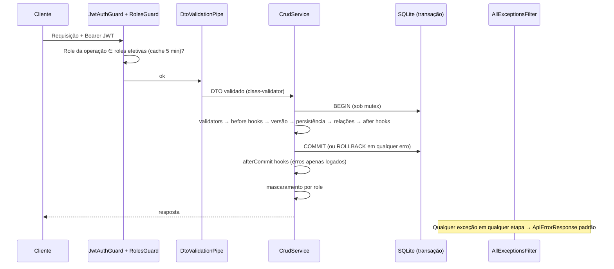

# Especificação: CRUD Genérico, Perfis/Permissões, Migrations e Tratamento Centralizado de Erros

> **Status:** APROVADA PARA PLANEJAMENTO (todas as questões Q1–Q9, G1–G19 e H1–H13 foram resolvidas; não há questões em aberto).
> **Plano técnico:** [specs/plan/crud-generico-plan.md](plan/crud-generico-plan.md)
> **Documentos relacionados:** [specs/auth.md](auth.md), [specs/arquitetura.md](arquitetura.md), [specs/design-system.md](design-system.md)

---

## 1. Visão Geral

### 1.1 História de usuário
**Como** desenvolvedor da plataforma,
**quero** uma base genérica de CRUD (service + controller) reutilizável por qualquer entidade,
**para** eliminar a repetição de código na construção de CRUDs, garantindo, de forma padronizada:
validação, controle de permissões por operação, hooks antes/depois de cada operação, validações de negócio antes da execução, concorrência otimista, mascaramento de dados sensíveis, auditoria do último usuário e **formato único de erro** devolvido ao frontend.

### 1.2 Escopo desta entrega
| Item | Incluído |
| :--- | :---: |
| Infraestrutura genérica de CRUD no backend (NestJS) | ✅ |
| Filtro global de exceções + formato padrão de erro | ✅ |
| Novo modelo de permissões: **Roles → Perfis → Usuários** (substitui `User.role`) | ✅ |
| Guard de permissões com cache de 5 minutos + endpoint de roles do usuário | ✅ |
| Migrations TypeORM (fim do `synchronize`) + migration inicial + seed idempotente do admin | ✅ |
| Migração do módulo `users` para o CRUD genérico | ✅ |
| Nova entidade `Categoria` (prova do CRUD, validação por hook, campo mascarado) | ✅ |
| Entidade `Perfil` com CRUD genérico | ✅ |
| Contratos compartilhados em `packages/utils` (`@repo/utils`) | ✅ |
| Frontend: **apenas** adaptação mínima para o novo modelo de permissões (seção 8) | ✅ |
| Telas/componentes genéricos de CRUD no frontend (listagem, formulário, cadastro de perfis, categorias) | ❌ (história futura) |
| Cache distribuído / múltiplas instâncias | ❌ |

### 1.3 Atores
| Ator | Descrição |
| :--- | :--- |
| Desenvolvedor | Cria um CRUD novo estendendo a base genérica de forma declarativa. |
| Usuário autenticado | Possui 0..N perfis; cada perfil agrupa roles; as roles efetivas do usuário são a união das roles dos seus perfis ativos. |
| Administrador | Usuário vinculado ao perfil de sistema "Administrador" (todas as roles, **exceto** `DADOS_SENSIVEIS`). |
| Frontend | Consome o formato padronizado de erro e o endpoint de roles. |

---

## 2. Visão Arquitetural



### 2.1 Estrutura de diretórios (backend) — obrigatória
```
apps/backend/src/
  common/
    exceptions/business.exception.ts            (existente; sem alteração de assinatura)
    exceptions/validation.exception.ts          (novo)
    filters/all-exceptions.filter.ts            (novo)
    crud/
      base.entity.ts
      crud.types.ts
      crud.service.ts
      create-crud-controller.ts
      crud.module.ts
      transaction-runner.ts
      crud-query.ts
      create-update-dto.ts
      masking/masked.decorator.ts
      masking/mask.service.ts
      pipes/dto-validation.pipe.ts
      decorators/current-user.decorator.ts
  auth/
    permissions/roles-catalog.ts
    permissions/operation.decorator.ts
    permissions/permissions.service.ts
    permissions/permissions.module.ts
    guards/roles.guard.ts                       (reescrito)
  perfis/    (entity, dto, service, controller, module, roles-catalog.controller.ts)
  categorias/(entity, dto, service, controller, module)
  users/     (entity alterada, dto, service, controller, module)
  database/
    data-source.ts
    cli-data-source.ts
    migrations/<timestamp>-InitialSchema.ts
    seed/seed.service.ts
```

---

## 3. Modelo de Permissões (Roles → Perfis → Usuários)

### 3.1 Definições
- **Role**: permissão individual, uma `string` definida **no código** (nunca cadastrada no banco).
- **Perfil**: entidade cadastrável (CRUD) que contém uma lista de roles.
- **Usuário**: vinculado a **um ou mais** perfis (muitos-para-muitos).
- **Roles efetivas** do usuário = união das `roles` de todos os perfis **ativos e não excluídos** do usuário. Usuário inativo (`ativo=false`) ou excluído logicamente ⇒ roles efetivas = `[]`.
- Usuário sem perfil: autenticado, porém sem roles ⇒ toda operação protegida por role retorna **403**.
- O campo `User.role` (`admin`/`user`) e o enum `Role` **deixam de existir**.

### 3.2 Convenção de nomes de roles
- Formato: `recurso:acao`, minúsculas, regex `^[a-z][a-z0-9-]*:[a-z][a-z0-9-]*$`.
- `recurso` = caminho da rota no plural (`users`, `perfis`, `categorias`).
- Operações do CRUD genérico: `create`, `read`, `update`, `delete`. **`findAll` e `findOne` compartilham a role `read`.** Exemplos: `categorias:create`, `categorias:read`, `categorias:update`, `categorias:delete`.
- Operações customizadas definem a própria role (ex.: `users:activate`, `users:reset-password`).
- Exceção ao formato: `DADOS_SENSIVEIS` (constante `SENSITIVE_DATA_ROLE`).
- Role fora do formato (e diferente de `DADOS_SENSIVEIS`) ⇒ o decorator lança `Error` no carregamento da aplicação (falha rápida).

### 3.3 Catálogo de roles
- `RolesCatalog` (classe estática, `roles-catalog.ts`): `register(role)`, `all(): string[]` (ordenado alfabeticamente, sem duplicatas), `isValid(role): boolean`, `clearForTests()`.
- Toda role usada em `@Operation(...)` é registrada automaticamente **no momento da decoração**. `DADOS_SENSIVEIS` é registrada manualmente em `permissions.module.ts`.
- Endpoint de consulta: `GET /roles` (role exigida: `perfis:read`) → `{ "roles": string[] }` (catálogo completo, para a futura tela de cadastro de perfis).

### 3.4 Decorator `@Operation(role)`
- `@Operation('recurso:acao')` em um handler: (a) valida o formato; (b) registra no catálogo; (c) grava metadata `OPERATION_KEY`; (d) aplica `@UseGuards(JwtAuthGuard, RolesGuard)`.
- É **o único meio** de proteger rotas por role, inclusive operações customizadas de qualquer CRUD.

### 3.5 `RolesGuard` (reescrito)
1. Lê `OPERATION_KEY` do handler (`Reflector.get`). **Ausente ⇒ nega (403 `FORBIDDEN`)** — deny-by-default.
2. Obtém `request.user` (`AuthenticatedUser`, preenchido pelo `JwtAuthGuard`). Ausente ⇒ 401 `UNAUTHORIZED`.
3. Consulta `PermissionsService.getEffectiveRoles(user.id)`; role exigida ausente ⇒ **403 `FORBIDDEN`** (mensagem: `Acesso negado: requer a role "<role>"`).
4. Corrige o bug atual (`requiredRoles.join` antes da verificação de `undefined`) — a lógica antiga é removida; sem logs que exponham o objeto `user`.

### 3.6 `PermissionsService` e cache
- `getEffectiveRoles(userId: string): Promise<ReadonlySet<string>>`.
- Cache em memória (`Map<userId, { roles, expiresAt }>`), **TTL = 5 minutos** (`PERMISSIONS_CACHE_TTL_MS = 300_000`).
- Invalidação imediata: `invalidate(userId)` e `invalidateAll()`. É chamada via hook `afterCommit` quando: qualquer `Perfil` é criado/alterado/excluído (`invalidateAll`); um `User` é criado/alterado/excluído/ativado (`invalidate(id)`); o seed altera o perfil Administrador (`invalidateAll`).
- Roles que não estejam mais no catálogo são descartadas do resultado.
- Módulo `PermissionsModule` é `@Global()` e exporta `PermissionsService`.

### 3.7 Endpoint de roles do usuário
`GET /auth/me/roles` — apenas `JwtAuthGuard` (sem `@Operation`) → `200 { "roles": string[] }` com as roles efetivas do usuário do token (ordenadas). Usado pelo frontend.

### 3.8 JWT
Payload passa a ser `{ sub, email, nome }` (**sem `role`**). O segredo é obrigatório: `JWT_SECRET` ausente ⇒ a aplicação **falha na inicialização** (`ConfigService.getOrThrow`); o valor padrão `'secretKey'` é removido. Expiração permanece 60 minutos.

---

## 4. Modelagem de Dados

Todos os `id` são UUID v4 em `varchar(36)`. Datas em UTC. Todas as entidades de negócio herdam de `BaseEntity`.

### 4.1 `BaseEntity` (classe abstrata)
| Campo | Tipo (TS) | Coluna | Regra |
| :--- | :--- | :--- | :--- |
| `id` | `string` | `@PrimaryGeneratedColumn('uuid')` | gerado |
| `version` | `number` | `@VersionColumn()` (integer, inicia em 1) | incrementa a cada UPDATE |
| `createdAt` | `Date` | `@CreateDateColumn()` | |
| `updatedAt` | `Date` | `@UpdateDateColumn()` | |
| `deletedAt` | `Date \| null` | `@DeleteDateColumn()` (nullable) | exclusão lógica |
| `ultimoUsuarioId` | `string \| null` | `@Column({ type: 'varchar', length: 36, nullable: true })` | id do último usuário que incluiu/alterou/excluiu. **Sem FK.** `null` em ações do sistema (seed, auto-cadastro). |

### 4.2 `Perfil` — tabela `perfis`
| Campo | Tipo | Regra |
| :--- | :--- | :--- |
| `nome` | `string` (varchar 100) | obrigatório; único entre registros não excluídos |
| `ativo` | `boolean` | default `true` |
| `roles` | `string[]` | `@Column({ type: 'simple-json' })`, default `[]`; cada item deve existir no `RolesCatalog` |
| `sistema` | `boolean` | default `false`; **somente o seed define `true`**; não aceito nos DTOs |

### 4.3 `User` — tabela `users` (alterada)
| Campo | Tipo | Regra |
| :--- | :--- | :--- |
| `email` | `string` | obrigatório, formato válido, **único no banco (inclusive excluídos)** |
| `nome` | `string` | obrigatório |
| `senha` | `string` | hash bcrypt (10 rounds); `@Column({ select: false })` — **nunca é retornada**; leitura apenas por `findByEmailWithPassword` |
| `ativo` | `boolean` | default `false` |
| `perfis` | `Perfil[]` | `@ManyToMany(() => Perfil)` + `@JoinTable({ name: 'users_perfis' })` |
| ~~`role`~~ | — | **removido** |

### 4.4 `Categoria` — tabela `categorias`
| Campo | Tipo | Regra |
| :--- | :--- | :--- |
| `nome` | `string` (varchar 100) | obrigatório; **único entre não excluídos** (validator + índice parcial `WHERE deletedAt IS NULL` como rede de segurança) |
| `ativo` | `boolean` | default `true` |
| `valor` | `number \| null` | **inteiro em centavos** (`integer`, nullable), `>= 0`; **mascarado** sem `DADOS_SENSIVEIS` |

### 4.5 Migrations (substitui `synchronize`)
- `synchronize: false` em todos os ambientes. `migrationsRun: true` (migrations executam na inicialização, inclusive no container Docker).
- `src/database/data-source.ts` exporta `dataSourceOptions` (usado pelo `AppModule` e pelo CLI); `src/database/cli-data-source.ts` exporta `default new DataSource(dataSourceOptions)`.
- `DATABASE_NAME` (padrão `database.sqlite`) continua sendo a configuração do arquivo.
- **Migration inicial** (`InitialSchema`): cria `users`, `perfis`, `users_perfis`, `categorias` com todas as colunas das seções 4.1–4.4 e o índice parcial de `categorias.nome`. É **gerada pelo CLI** a partir das entidades contra um banco vazio e revisada; `down()` remove tudo.
- Scripts em `apps/backend/package.json`: `typeorm`, `migration:generate`, `migration:run`, `migration:revert`.
- **Bancos existentes** (arquivo criado por `synchronize`): devem ser descartados (apagar `database.sqlite` local; remover o volume `sqlite_data` no Docker). Documentado em `docs/migrations.md`.

### 4.6 Seed (idempotente, executado após as migrations)
`SeedService` (`OnApplicationBootstrap`), em uma única transação, sem passar pelo CRUD genérico (`ultimoUsuarioId = null`):
1. **Perfil "Administrador"** (`ADMIN_PERFIL_NOME`): se não existir, cria com `sistema=true`, `ativo=true`. Em **toda** inicialização sincroniza `roles = RolesCatalog.all() − [DADOS_SENSIVEIS]` (atualiza só se diferir) e chama `PermissionsService.invalidateAll()`.
2. **Usuário admin**: e-mail `ADMIN_EMAIL` (padrão `admin@ueg.br`), nome `Administrador`, senha `ADMIN_PASSWORD`, `ativo=true`, vinculado ao perfil Administrador. **Criado somente se o e-mail não existir** (usuário existente nunca é alterado).
   - `ADMIN_PASSWORD` ausente: em `NODE_ENV !== 'production'` usa `admin123`; em `production` a aplicação **falha na inicialização** com erro claro.
3. Remove `users/seed.ts` e `UsersService.createAdmin`.

---

## 5. CRUD Genérico

### 5.1 Endpoints gerados por `createCrudController` (recurso `<r>`)
| Método e rota | Operação | Role | Sucesso |
| :--- | :--- | :--- | :--- |
| `POST /<r>` | create | `<r>:create` | `201` entidade criada |
| `GET /<r>` | findAll | `<r>:read` | `200` `PageResult<T>` |
| `GET /<r>/:id` | findOne | `<r>:read` | `200` entidade |
| `PATCH /<r>/:id` | update | `<r>:update` | `200` entidade atualizada |
| `DELETE /<r>/:id?version=N` | remove | `<r>:delete` | `204` sem corpo |

`:id` deve ser UUID (`ParseUUIDPipe` ⇒ 400 `VALIDATION_ERROR`). O controller concreto é `class XController extends createCrudController(...)` com `@Controller('<r>')` próprio; rotas extras são métodos do controller concreto decorados com `@Operation(...)`.

### 5.2 Configuração declarativa (`CrudConfig`)
```ts
interface CrudConfig<E extends BaseEntity, C extends object, U extends object> {
  resource: string;                      // 'categorias' — prefixo das roles e da rota
  entity: EntityClass<E>;
  createDto: Type<C>;
  updateDto: Type<U>;                    // gerado por createUpdateDto(CreateDto)
  deleteMode?: 'soft' | 'hard';          // padrão 'soft'
  relations?: string[];                  // relações carregadas em findOne/findAll/respostas (ex.: ['perfis'])
  relationInputFields?: string[];        // campos do DTO que NÃO são colunas (ex.: ['perfilIds'])
  filters?: Record<string, FilterRule>;  // filtros permitidos (5.8)
  sortable?: string[];                   // campos ordenáveis
}
interface FilterRule { type: 'string'|'number'|'boolean'|'date'|'uuid'; operators: FilterOperator[]; }
type FilterOperator = 'eq'|'ne'|'like'|'gt'|'gte'|'lt'|'lte'|'in'|'between';
```
Os DTOs, as roles e os hooks/validators são **tudo** que o desenvolvedor informa para ter um CRUD completo.

### 5.3 Ordem de execução e transação (Q1/Q2)
Mutações (`create`, `update`, `remove`) — **tudo na mesma transação**, nesta ordem:
1. Guard de role (fora da transação).
2. Validação estrutural do DTO (`DtoValidationPipe`).
3. Abre transação (`TransactionRunner.runInTransaction`).
4. Carrega registro existente (update/remove; inexistente/excluído ⇒ 404 `RESOURCE_NOT_FOUND`).
5. Checagem de campos mascarados no input sem role (⇒ 403, seção 5.7) e **checagem de versão** (update/remove, seção 5.6).
6. **Validators** de negócio da operação (em ordem de registro).
7. **Before hooks** da operação (podem alterar `ctx.input`).
8. Persistência (scalares) + `syncRelations` (relações N:N, quando houver).
9. **After hooks** da operação (recebem a entidade persistida; **fazem parte da transação**: falha ⇒ rollback total).
10. Recarrega a entidade (com `relations`), `COMMIT`.
11. **AfterCommit hooks** (fora da transação, erros apenas logados — para efeitos externos como e-mail e invalidação de cache).
12. Mascaramento por role e resposta.

Qualquer exceção nas etapas 4–10 ⇒ `ROLLBACK` e propagação ao filtro global.
Leituras (`findAll`, `findOne`) não abrem transação, mas executam sob o mesmo mutex; aplicam **afterFind hooks** por registro e depois o mascaramento.

### 5.4 `TransactionRunner` (mutex para SQLite)
O driver SQLite do TypeORM compartilha **uma única conexão/queryRunner**; transações concorrentes falham. Portanto:
- `runInTransaction(fn: (m: EntityManager) => Promise<T>)`: enfileira e executa `dataSource.transaction(fn)` de forma **estritamente serial** (fila de promises; falha de uma não trava a fila).
- `runExclusive(fn: (m: EntityManager) => Promise<T>)`: executa sem BEGIN, na mesma fila (leituras).
- **Regra para hooks/validators:** usar **somente** `ctx.manager`; **nunca** chamar métodos públicos de outro `CrudService` (causaria deadlock por reentrada). Escritas fora do CRUD (auto-cadastro, ativação, troca de senha, seed) também usam `runInTransaction`.

### 5.5 Hooks e validators
```ts
interface CrudContext<E, I> {
  operation: 'create'|'findAll'|'findOne'|'update'|'remove';
  manager: EntityManager;               // transacional
  user: AuthenticatedUser | null;
  input: I;                             // DTO (mutável em before hooks); {} em remove
  existing: E | null;                   // null em create
  userRoles: ReadonlySet<string>;
}
type CrudValidator<E, I>  = (ctx: CrudContext<E, I>) => void | Promise<void>;
type CrudBeforeHook<E, I> = (ctx: CrudContext<E, I>) => void | Promise<void>;
type CrudAfterHook<E, I>  = (entity: E, ctx: CrudContext<E, I>) => void | Promise<void>;
type CrudAfterFindHook<E> = (entity: E, ctx: CrudContext<E, never>) => void | Promise<void>;
```
API pública do `CrudService` (registrada no construtor do serviço concreto, permitindo closures com dependências injetadas):
`addValidator(op, fn)`, `addBeforeHook(op, fn)`, `addAfterHook(op, fn)`, `addAfterCommitHook(op, fn)`, `addAfterFindHook(fn)` onde `op ∈ 'create'|'update'|'remove'`.
- Múltiplos registros executam na ordem de registro; o primeiro que lançar interrompe a operação.
- Validators não alteram dados; before hooks podem.
- Ponto de extensão protegido: `protected syncRelations(id, input, ctx): Promise<void>` (padrão: no-op) e `protected mapInputToEntity(input, ctx): DeepPartial<E>` (padrão: cópia do input sem `version` e sem `relationInputFields`).

### 5.6 Concorrência otimista (`version`)
- `update`: DTO exige `version` (inteiro ≥ 1); `remove`: query `?version=N` obrigatória.
- `version` ausente/não inteiro/`< 1` ⇒ **400 `VALIDATION_ERROR`**.
- Versão informada ≠ versão atual ⇒ **409 `OPTIMISTIC_LOCK_CONFLICT`** (mensagem: "O registro foi alterado por outro usuário. Recarregue e tente novamente.").
- A gravação é um **UPDATE condicional** (`WHERE id = :id AND version = :version`); se `affected = 0` ⇒ mesmo 409. O TypeORM incrementa `version` e atualiza `updatedAt` automaticamente.
- Toda resposta de entidade inclui `version`.
- `PATCH /users/:id/activate` e demais operações customizadas **não** exigem `version` (atualizam atomicamente).

### 5.7 Mascaramento de dados sensíveis (G5/G10/G14)
- Decorator de propriedade `@Masked({ role?, maskValue?, maskFn? })` (`masked.decorator.ts`):
  - `role`: role que libera o valor real; padrão `SENSITIVE_DATA_ROLE`.
  - `maskValue`: valor fixo de máscara.
  - `maskFn(value, entity)`: função **opcional** de máscara customizada (precede `maskValue`).
- Resolução (sem a role): valor `null/undefined` ⇒ permanece; `maskFn` ⇒ resultado dela; senão `maskValue` se definido; senão padrão por tipo: **numérico ⇒ `99999`** (`MASK_DEFAULT_NUMERIC`; para monetário em centavos = 999,99), `string` ⇒ `'********'`, outros ⇒ `null`.
- `Categoria.valor` usa `@Masked({ maskValue: 99999 })`.
- `MaskService.apply(entity, roles)` devolve **cópia** (não muta a entidade) e é aplicado em **todas** as respostas: findAll, findOne, create, update. Atua apenas em campos de primeiro nível.
- **Escrita**: create/update com campo mascarado presente no DTO (valor `!== undefined`) por usuário sem a role ⇒ **403 `FORBIDDEN_SENSITIVE_FIELD`**, mensagem `O campo "valor" exige a role DADOS_SENSIVEIS`.
- **Filtro/ordenação** por campo mascarado sem a role ⇒ 403 `FORBIDDEN_SENSITIVE_FIELD` (impede inferência do valor).

### 5.8 Listagem (`GET /<r>`)
Query string **plana** (Express 5 não interpreta `a[b]=c`):
| Parâmetro | Regra |
| :--- | :--- |
| `page` | inteiro ≥ 1; padrão 1 |
| `limit` | inteiro 1–**5000**; padrão **10** |
| `sort` | lista separada por vírgula; prefixo `-` = decrescente (ex.: `nome,-valor`); campos devem estar em `sortable`; padrão `createdAt,id` |
| `<campo>` | filtro `eq` |
| `<campo>__<op>` | filtro com operador (`ne`, `like`, `gt`, `gte`, `lt`, `lte`, `in`, `between`) |
- `in`: valores separados por vírgula; `between`: exatamente dois valores `min,max` (inclusivos); `like`: contém, case-insensitive (`LOWER(col) LIKE LOWER('%v%')`; `%` e `_` do usuário não são escapados).
- Coerção por `type` do `FilterRule` (`number` finito; `boolean` apenas `true|false`; `date` ISO-8601 válido; `uuid` formato UUID).
- Campo não declarado em `filters`/`sortable` ou operador não permitido ⇒ **400 `QUERY_FIELD_NOT_ALLOWED`**; valor inválido, `page`/`limit` fora da faixa ⇒ **400 `QUERY_PARAM_INVALID`**. Parâmetros desconhecidos são tratados como filtro (e rejeitados se não declarados).
- Exclusão lógica: registros com `deletedAt` nunca aparecem.
- Resposta `PageResult<T> = { items, total, page, limit }`.

### 5.9 Auditoria (`ultimoUsuarioId`)
`create`, `update` e `remove` em modo soft (no modo hard não há registro a auditar) gravam `ultimoUsuarioId = user?.id ?? null`. O usuário é passado explicitamente do controller (`@CurrentUser()`) ao service (`create(dto, user)`).

### 5.10 Exclusão
`deleteMode='soft'` (padrão): UPDATE condicional definindo `deletedAt = now()` e `ultimoUsuarioId`. `'hard'`: DELETE condicional `WHERE id AND version`. Violação de FK ⇒ 409 `RESOURCE_IN_USE`.

---

## 6. Tratamento Centralizado de Erros

### 6.1 Formato padrão (`ApiErrorResponse`, em `@repo/utils`)
```json
{
  "statusCode": 400,
  "error": "VALIDATION_ERROR",
  "message": "Dados inválidos",
  "details": [{ "field": "nome", "message": "O nome é obrigatório" }],
  "path": "/categorias",
  "timestamp": "2026-10-27T22:00:00.000Z"
}
```
`error` é sempre o **código** em caixa alta (compatível com o contrato atual lido pelo frontend). `details` só existe em erros de validação. `path` = URL da requisição sem query string.

### 6.2 Como o caso de uso especifica o erro
O caso de uso lança `new BusinessException(mensagem, CODIGO, status)` (código em `@repo/utils`/`ERROR_CODES` ou específico do domínio); **não formata resposta**. Quem formata é **exclusivamente** o `AllExceptionsFilter`, registrado globalmente via `APP_FILTER`.

### 6.3 Regras de conversão do filtro (`@Catch()` — captura tudo)
| Origem | Status | `error` |
| :--- | :--- | :--- |
| `BusinessException` | o da exceção | o código da exceção (preservado) |
| `ValidationException` (DTO, query, pipes) | 400 | `VALIDATION_ERROR` + `details[]` |
| `UnauthorizedException` | 401 | `UNAUTHORIZED` |
| `ForbiddenException` | 403 | `FORBIDDEN` |
| `NotFoundException` (rota inexistente) / `EntityNotFoundError` | 404 | `RESOURCE_NOT_FOUND` |
| Outras `HttpException` 400 / 409 | 400 / 409 | `BAD_REQUEST` / `RESOURCE_CONFLICT` |
| Outras `HttpException` | status | `HTTP_ERROR` |
| `QueryFailedError` com `UNIQUE constraint failed` | 409 | `RESOURCE_CONFLICT` |
| `QueryFailedError` com `FOREIGN KEY constraint failed` | 409 | `RESOURCE_IN_USE` |
| Qualquer outra | 500 | `INTERNAL_ERROR` (mensagem genérica "Erro interno do servidor"; stack **somente no log**) |

### 6.4 Catálogo de códigos
| Código | Status | Quem lança |
| :--- | :--- | :--- |
| `VALIDATION_ERROR` | 400 | DTO/params/`version` ausente |
| `QUERY_PARAM_INVALID` | 400 | `crud-query` |
| `QUERY_FIELD_NOT_ALLOWED` | 400 | `crud-query` |
| `UNAUTHORIZED` | 401 | guards |
| `FORBIDDEN` | 403 | `RolesGuard` |
| `FORBIDDEN_SENSITIVE_FIELD` | 403 | `CrudService`/`crud-query` |
| `RESOURCE_NOT_FOUND` | 404 | `CrudService` |
| `OPTIMISTIC_LOCK_CONFLICT` | 409 | `CrudService` |
| `RESOURCE_CONFLICT` / `RESOURCE_IN_USE` | 409 | filtro (erros de banco) |
| `INTERNAL_ERROR` | 500 | filtro |
| `CATEGORIA_NOME_EXISTS` | 409 | validator de Categoria |
| `PERFIL_NOME_EXISTS` | 409 | validator de Perfil |
| `PERFIL_ROLE_INVALID` | 400 | validator de Perfil |
| `PERFIL_SISTEMA_PROTEGIDO` | 409 | validator de Perfil |
| `PERFIL_IN_USE` | 409 | validator de Perfil (remove com usuários vinculados) |
| `USER_EMAIL_EXISTS` | 409 | validator de User (CRUD) |
| `USER_PERFIL_INVALID` | 400 | validator de User |
| `USER_LAST_ADMIN` | 409 | validator de User |
| `USER_NOT_FOUND` | 404 | `UsersService.findById` (status alterado de 400 para 404) |
| `AUTH_*` existentes | inalterado | auth (`AUTH_EMAIL_EXISTS` do auto-cadastro continua 400) |

---

## 7. Regras de Negócio por Entidade

### 7.1 Categoria (recurso `categorias`)
- DTO create: `nome` (`@IsString @IsNotEmpty @MaxLength(100)`, `@Transform` trim), `ativo?` (`@IsBoolean`), `valor?` (`@IsOptional @IsInt @Min(0)`; omitido ⇒ gravado como `null`; `null` explícito não é aceito).
- Validator `create` e `update` **(usa a infraestrutura de hooks — requisito de arquitetura)**: se existir outra `Categoria` não excluída com mesmo `nome` (comparação case-insensitive, exclui o próprio id no update) ⇒ `CATEGORIA_NOME_EXISTS` (409, "Já existe uma categoria com este nome").
- Roles: `categorias:create|read|update|delete`. `valor` real exige `DADOS_SENSIVEIS`.
- `deleteMode: 'soft'`; `filters`: `nome: {string,[eq,like]}`, `ativo: {boolean,[eq]}`, `valor: {number,[eq,gt,gte,lt,lte,between]}`, `createdAt: {date,[gte,lte,between]}`; `sortable`: `nome, ativo, valor, createdAt, updatedAt`.

### 7.2 Perfil (recurso `perfis`)
- DTO create: `nome` (obrigatório, ≤100, trim), `ativo?`, `roles` (`@IsArray @ArrayUnique @IsString({each})`).
- Validators: nome único entre não excluídos (`PERFIL_NOME_EXISTS`); toda role ∈ `RolesCatalog` (`PERFIL_ROLE_INVALID`, mensagem lista as inválidas); `update`/`remove` de perfil com `sistema=true` ⇒ `PERFIL_SISTEMA_PROTEGIDO`; `remove` com usuários (não excluídos) vinculados ⇒ `PERFIL_IN_USE`.
- AfterCommit (create/update/remove): `PermissionsService.invalidateAll()`.
- `filters`: `nome {string,[eq,like]}`, `ativo {boolean,[eq]}`; `sortable`: `nome, ativo, createdAt`.

### 7.3 User (recurso `users`) — migrado para o CRUD genérico
- `CreateManagedUserDto`: `email` (`@IsEmail`), `nome`, `senha` (`@MinLength(6)`), `ativo?` (padrão `true` quando criado pelo admin), `perfilIds?: string[]` (`@IsUUID('4',{each})`, `@ArrayUnique`). `UpdateManagedUserDto` = parcial de `{email, nome, ativo, perfilIds}` + `version` (**`senha` não é aceita no update**; `forbidNonWhitelisted` ⇒ 400).
- `relationInputFields: ['perfilIds']`; `relations: ['perfis']`.
- BeforeHook `create`: substitui `input.senha` pelo hash bcrypt (10).
- `syncRelations`: se `perfilIds` definido, substitui a lista de perfis do usuário (`manager.createQueryBuilder().relation(User, 'perfis').of(id).addAndRemove(...)`); `[]` remove todos; `undefined` mantém.
- Validators: e-mail único (inclusive excluídos; `USER_EMAIL_EXISTS`); `perfilIds` devem existir, não excluídos e **ativos** (`USER_PERFIL_INVALID`); **proteção do último admin** (`USER_LAST_ADMIN`): bloqueia `update` que inative o usuário ou remova o perfil Administrador, e bloqueia `remove`, quando ele é o **único** usuário ativo e não excluído com o perfil de sistema Administrador.
- AfterCommit: `PermissionsService.invalidate(id)`.
- Resposta nunca contém `senha`. `filters`: `email {string,[eq,like]}`, `nome {string,[eq,like]}`, `ativo {boolean,[eq]}`, `createdAt {date,[gte,lte,between]}`; `sortable`: `email, nome, ativo, createdAt`.
- Operações customizadas preservadas: `PATCH /users/:id/activate` (role `users:activate`; marca `ativo=true`, grava `ultimoUsuarioId`, invalida cache) e `POST /users/:id/reset-password` (role `users:reset-password`; comportamento atual).
- **Auto-cadastro** (`POST /auth/register`) **permanece no `AuthController`** (público), via `UsersService.registerSelf(dto)`: `ativo=false`, **sem perfis**, `ultimoUsuarioId=null`, `AUTH_EMAIL_EXISTS` (400) se o e-mail existir; retorna `{ id, email, nome, ativo }` (sem hash). O admin atribui perfis e ativa o usuário depois.
- Login (`AuthService.validateUser`) usa `findByEmailWithPassword`; ordem de verificações e códigos `AUTH_*` inalterados.

---

## 8. Frontend (escopo mínimo — H6)
- `AuthService`: remove `role` do tipo `User` e do payload; adiciona `roles` (signal), `loadRoles()` (`GET /auth/me/roles`, chamado após login — antes de o componente navegar — e na inicialização quando há token válido), `hasRole(role)`; **remove `isAdmin`** (substituído por `hasRole('users:read')`).
- `adminGuard` é substituído por `roleGuard(role)` (factory de `CanActivateFn`) que aguarda o carregamento das roles; sem a role ⇒ `/access-denied`. Rota `/admin` usa `roleGuard('users:read')`.
- Redirecionamentos raiz/`**`: `/admin` se `hasRole('users:read')`, senão `/dashboard`.
- `users-list`: `getUsers()` passa a chamar `GET /users?limit=5000` e usar `items`; remove coluna/badge de `role` e exibe os nomes dos `perfis`.
- Demais usos de `role`/`isAdmin` (header etc.) ajustados; testes existentes atualizados.
- Erros: `parseAuthError` continua lendo `error.error.error` (compatível). Exclusão com modal customizado permanece regra para futuras telas.

---

## 9. Contratos Compartilhados (`@repo/utils`)
Estrutura `packages/utils/src/contracts/`: `api-error.ts` (`ApiErrorDetail`, `ApiErrorResponse`), `pagination.ts` (`PageResult<T>`, `PAGE_DEFAULT_LIMIT=10`, `PAGE_MAX_LIMIT=5000`), `error-codes.ts` (`ERROR_CODES` com todos os códigos da seção 6.4), `permissions.ts` (`SENSITIVE_DATA_ROLE`, `ROLE_FORMAT`, `ADMIN_PERFIL_NOME`, `MASK_DEFAULT_NUMERIC=99999`), `entities.ts` (`PerfilDto`, `CategoriaDto`, `UserDto`, `UserRolesResponse`). Tudo exportado por `index.ts`. O pacote passa a **compilar para `dist`** (`main`/`types` apontando para `dist`) para ser consumível pelo backend em runtime. Proibido `any`.

---

## 10. Configuração e Documentação
- Variáveis: `JWT_SECRET` (obrigatória), `DATABASE_NAME`, `ADMIN_EMAIL`, `ADMIN_PASSWORD` (obrigatória em produção). Atualizar `.env.example` e `docker-compose.yml`.
- `main.ts`: `ValidationPipe` global (`whitelist: true`, `forbidNonWhitelisted: true`, `transform: true`).
- Criar `docs/migrations.md`; atualizar `specs/arquitetura.md` (seed, guards, erros, permissões) e `specs/auth.md` (substituir "role enum" por perfis).

---

## 11. Critérios de Aceitação
- [ ] Criar um CRUD novo exige apenas: entidade, DTOs, `CrudConfig`, service/controller vazios e (opcional) hooks/validators.
- [ ] Todas as operações respeitam a role própria (`recurso:create|read|update|delete`); rota sem `@Operation` é negada.
- [ ] Validators bloqueiam antes da persistência; before/after hooks executam na ordem; falha em qualquer etapa (inclusive after hook) desfaz tudo.
- [ ] Concorrência otimista: versão divergente ⇒ 409 `OPTIMISTIC_LOCK_CONFLICT`; ausente ⇒ 400.
- [ ] `Categoria.valor` aparece como `99999` sem `DADOS_SENSIVEIS`; escrita/filtro/ordenação sem a role ⇒ 403 `FORBIDDEN_SENSITIVE_FIELD`.
- [ ] Unicidade de `Categoria.nome` implementada por validator (hook), reutilizável após exclusão lógica.
- [ ] Listagem: `limit` padrão 10, máximo 5000; filtros/ordenação restritos à configuração.
- [ ] Todo erro (incluindo exceções inesperadas e erros de banco) sai no formato `ApiErrorResponse`.
- [ ] `ultimoUsuarioId` preenchido em create/update/remove.
- [ ] Perfis/roles: roles efetivas via `GET /auth/me/roles`; guard usa cache de 5 min com invalidação imediata nas alterações.
- [ ] `synchronize` removido; migration inicial aplica em banco vazio; seed idempotente cria Administrador e admin; `JWT_SECRET` ausente derruba a inicialização.
- [ ] Último admin não pode ser inativado/removido/perder o perfil.
- [ ] Frontend continua funcional (login, `/admin`, listagem de usuários) com o novo modelo.
- [ ] `pnpm test`, `pnpm lint`, `pnpm typecheck` e `pnpm build` passam; nenhum `any`.

---

## 12. Registro de Decisões (rastreabilidade)
| Origem | Decisão |
| :--- | :--- |
| Q1/Q2 | validators, before, persistência e after na mesma transação; after com falha ⇒ rollback |
| Q3/G8/G11 | role própria por operação; operações extras via `@Operation` |
| Q4–Q6 | paginação/filtros, soft delete padrão, hook de leitura só para `afterFind` |
| Q7 | frontend genérico fora do escopo |
| Q8 | migrar `users`; criar `Categoria` |
| Q9 | formato de erro estendido mantendo `error` = código |
| G1 | efeitos externos fora da transação (`afterCommit`) |
| G2/G3/G12/G13 | Roles→Perfis→Usuários; admin sem `DADOS_SENSIVEIS`; endpoint de roles + cache 5 min |
| G4/G5/G10/G14 | `valor` em centavos; máscara 99999; decorator com função opcional; 403 em escrita/filtro |
| G6/G17 | `deletedAt` para exclusão lógica; unicidade ignora excluídos |
| G7 | auto-cadastro fora do CRUD |
| G9/H11/H13 | migrations; recriar bancos antigos; testes de integração com migrations |
| G15/G16 | limite 5000; `version` ausente = 400 |
| G18 | sem segredo JWT padrão; guard corrigido |
| G19/H12 | `ultimoUsuarioId` sem FK |
| H1–H10 | catálogo no código; `recurso:acao`; Administrador sincronizado no seed; proteção do último admin; cache com invalidação; frontend mínimo; `GET /auth/me/roles`; usuário sem perfil sem roles; `ADMIN_PASSWORD` por env |
